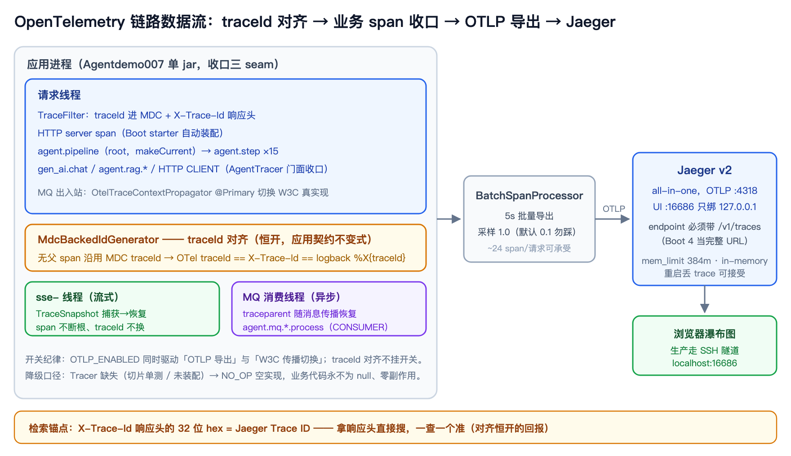
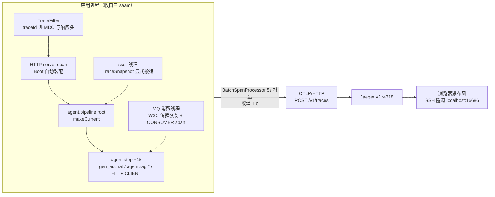
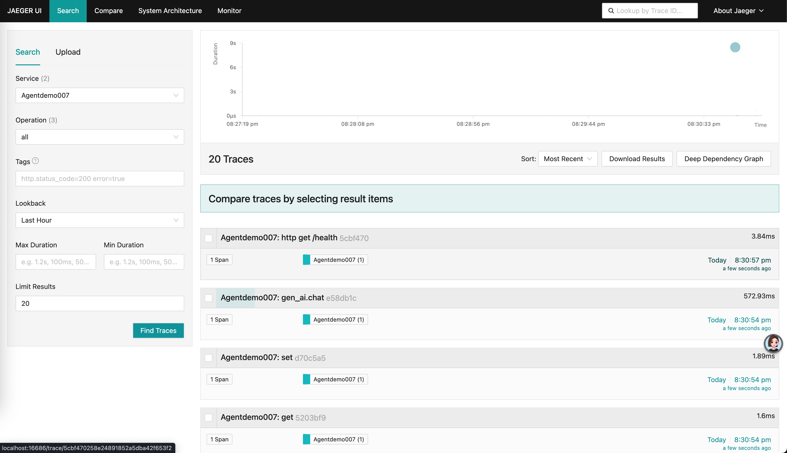
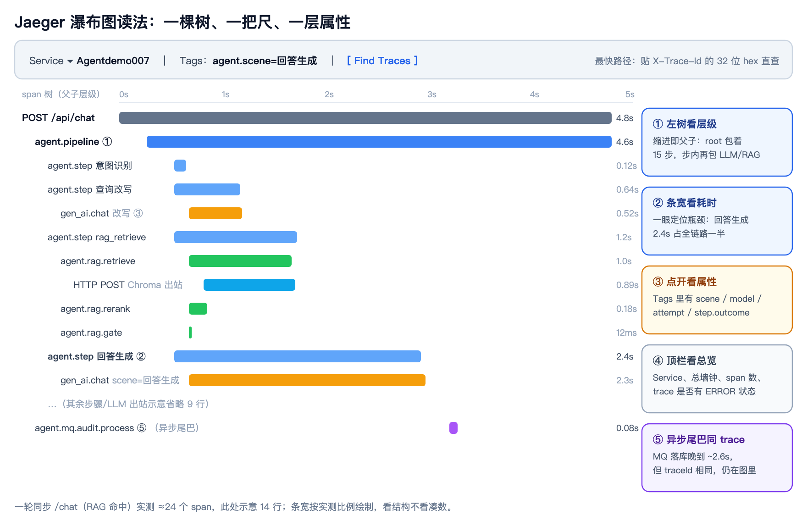
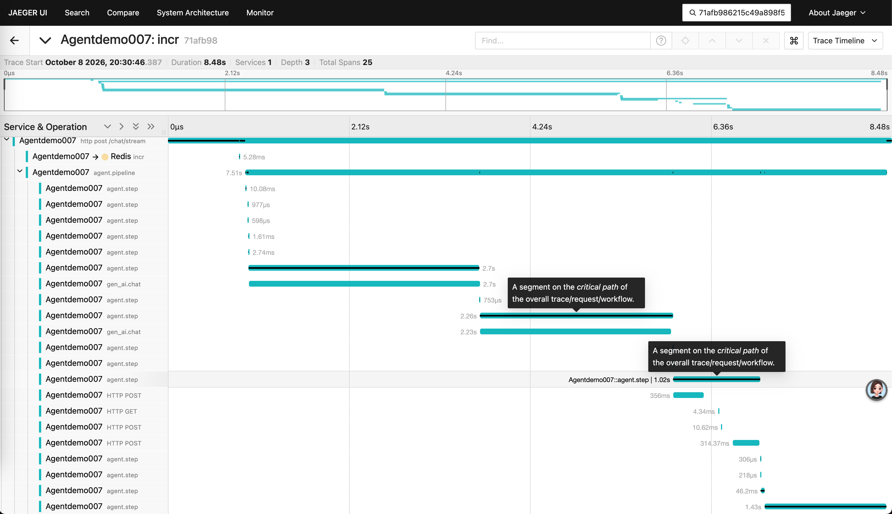
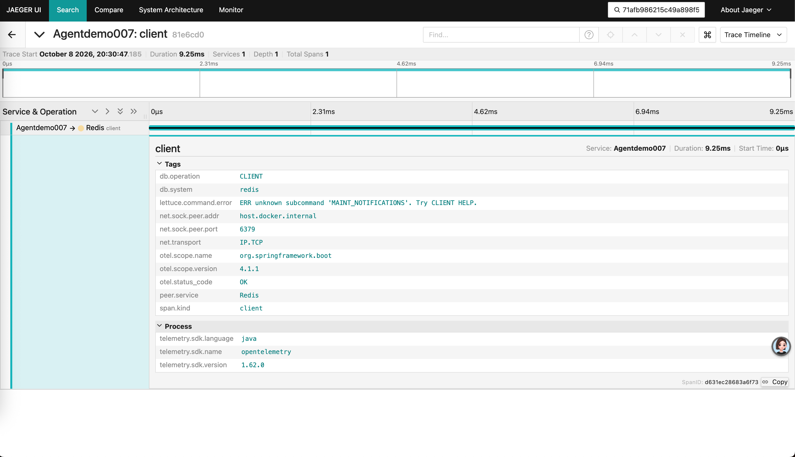
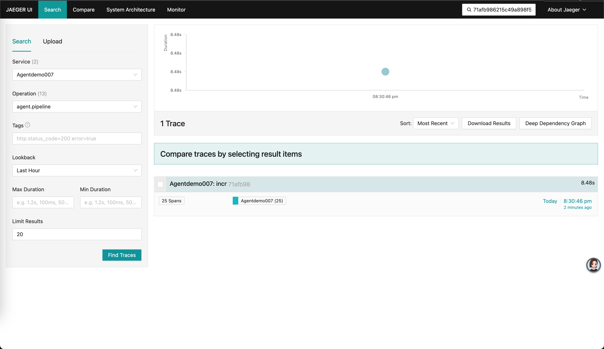
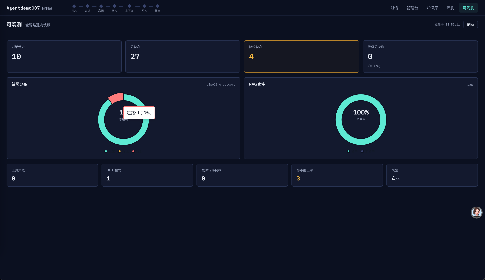

# 链路可视化：OpenTelemetry 埋点与 Jaeger——从一条 traceId 线到一张瀑布图

> **语言 / Language**：中文 ｜ 系列第十三章（[目录](./README.md)）｜ 上一章：[部署交付实录](./2026-09-21-deploy-delivery-hardening.zh.md)
>
> **项目**：Agentdemo007 —— 电商智能客服 Agent
> **技术栈**：spring-boot-starter-opentelemetry（Boot 4.1.1 原生，OTel SDK 1.62）/ Micrometer Tracing 桥接 / OTLP over HTTP / Jaeger v2 all-in-one / micrometer-registry-prometheus
> **周期**：2026-10-08 一日内集成 + 本地 Jaeger 端到端验证 + 生产 runbook 与部署链路加固（Docker 构建解堵）
> **验证规模**：新增 16 个单测（IdGenerator 兜底 / 传播往返 / 上下文快照 / span 层级 InMemory exporter 全量断言）+ 全量 1378 绿；本地一轮同步对话实测 24 span 瀑布、SSE 流式路径 21 span 同链路（断链修复实证）

---

## 核心结论

第十一章的 trace 信道是"一条线"：traceId 贯穿日志与响应头，出问题能定位，但看不见结构——15 步里哪步慢、LLM 重试在第几次、RAG 漏斗三段各占多少，全靠日志肉眼对表。这一章把它升级成"一张图"：OpenTelemetry SDK 埋点（Boot 4 原生 starter，不用 javaagent，部署链路零改动），15 步流水线、LLM 出站、RAG 漏斗、HTTP 出站、MQ 消费各有 span，Jaeger 瀑布图一屏读完一轮对话。工程上有四件事值得记：①**traceId 对齐做成应用契约不变式**（恒开、不挂导出开关）——用户拿响应头里的 X-Trace-Id 就能在 Jaeger 搜到这条链，这是"对齐"存在的唯一意义；②埋点走既有 seam 收口（传播器 @Primary 替换、AgentTracer 门面、IdGenerator 定制器），业务代码零感知 OTel 类型；③Boot 4 的属性前缀分裂与"endpoint 是完整 URL"两个坑让 Jaeger 一度零数据——**观测组件"安静地什么都不做"是它最危险的失败模式**；④外加一次 Docker 构建解堵：浮动基础镜像 tag 被上游换底座引发 apt 雪崩，最终解法不是换源也不是翻墙预装，而是**消灭 RUN 层**、探活改用 bash 内建 /dev/tcp。

## 一、为什么升级：三条信道没回答的三个问题

第十一章收口了 trace（MDC+JSON 日志）/ audit（append-only）/ progress（SSE）三条信道，但留了三个已知缺口，这一章全部由 OTel 集成一次补齐：

1. **耗时结构缺失**。`/api/obs/summary` 有总时长与步骤状态分布，但 per-step Timer 从 Phase 15 起就是欠账（第十一章原文承认），RAG 三段漏斗同样无分段耗时。"慢在哪个环节"只能翻日志。
2. **SSE 线程断链（借机修掉的线上 bug）**。`/chat/stream` 把流水线扔进 sse- 线程池执行，OTel context 与 MDC 都不随线程池传播——这不仅影响观测，还会让 `PipelineContext` 在 sse 线程兜底生成新 traceId，与响应头 `X-Trace-Id` 不一致（前端展示的 traceId 在后端检索不到，详见第六节）。
3. **`/actuator/prometheus` 404 半成品**。此前只加了 endpoint 配置没补注册表依赖，顺手补上 `micrometer-registry-prometheus`，metrics 信道从此有标准出口（Grafana 面板二期再接）。

选型三问三答（都选了最保守的那条路）：

| 决策点 | 选项 | 定案与理由 |
|---|---|---|
| 埋点方式 | javaagent 无侵入 vs SDK 埋点 | **SDK 埋点**：不往启动命令里塞 agent（部署链路零改动），高价值 span 由代码收口，命名单一出口 |
| 可视化后端 | Jaeger / Tempo / Zipkin | **Jaeger**：all-in-one 一个容器、OTLP 原生接入、UI 足够轻（2核4G 服务器只养得起 384m） |
| 落地范围 | 一步到生产 vs 本地先跑通 | **本地先跑通**：生产只写 runbook（部署实录 §9），搬运链路复用既有 save/scp/load |

## 二、收口路线：不推翻任何东西的三个 seam

老规矩，集成类需求先回答"接在哪"。三个 seam 全是既有结构：

**seam 1：传播器 @Primary 替换。** `TraceContextPropagator` 接口的 javadoc 在当初写 MQ 传播时就预留了"prod 换 OTel 原生实现"的位置。`OtelTraceContextPropagator` 注入 OTel `OpenTelemetry` bean、委托其 W3C propagator 完成 inject/extract，`restoreScope` 同时恢复 OTel scope 与 MDC；`@ConditionalOnProperty(app.otel.enabled)` 控制开关，关掉时 `MdcTraceContextPropagator` 兜底，行为与引入 OTel 前完全一致。MQ 出入站代码零改动。

**seam 2：span 门面。** `AgentTracer` 之于 span = `AgentMetrics` 之于指标：所有手动 span 只经此门面创建，业务代码只认 `SpanHandle`（attr/error/end/makeCurrent），不感知 `io.opentelemetry.*` 类型——OTel API 的使用被圈死在 observability 包内。非 Spring 单测与未装配场景走 `NO_OP` 空实现，句柄永不为 null、零副作用：

```java
// observability/AgentTracer.java —— span 门面（与 AgentMetrics 同哲学）
public SpanHandle startSpan(String name, SpanKind kind, String... attrKv) {
    if (tracer == null) {
        return SpanHandle.NO_OP_HANDLE;          // ②每步降级：埋点缺失不影响业务
    }
    try {
        SpanBuilder builder = tracer.spanBuilder(name).setSpanKind(kind);
        for (int i = 0; i + 1 < attrKv.length; i += 2) {
            if (attrKv[i + 1] != null) {
                builder.setAttribute(attrKv[i], attrKv[i + 1]);   // null 值不落 span
            }
        }
        return new SpanHandle(builder.startSpan());
    } catch (Exception e) {
        return SpanHandle.NO_OP_HANDLE;          // 防御性收口：埋点故障不影响主链路
    }
}
```

**seam 3：IdGenerator 定制器——traceId 对齐。** 这是整个集成里最值钱的一个决定。OTel SDK 默认随机生成 traceId，与应用 traceId（`TraceFilter` 写 MDC、回写 `X-Trace-Id` 响应头）是两套值——用户拿着响应头去 Jaeger 搜会查不到，"对齐"就没有意义。解法是经 `SdkTracerProviderBuilderCustomizer` 换上 MDC 回填的 IdGenerator：

```java
// observability/trace/MdcBackedIdGenerator.java —— 无父 span 沿用 MDC traceId
@Override
public String generateTraceId() {
    String mdc = MDC.get(TraceId.MDC_KEY);
    String normalized = TraceId.normalize(mdc);      // 32-hex 校验，非法退随机
    return (normalized != null) ? normalized : delegate.generateTraceId();
}
```

```java
// observability/trace/OtelObservabilityConfig.java —— 恒开，不挂 app.otel.enabled
@Configuration
public class OtelObservabilityConfig {
    @Bean
    public SdkTracerProviderBuilderCustomizer mdcBackedIdGeneratorCustomizer() {
        return builder -> builder.setIdGenerator(new MdcBackedIdGenerator());
    }
}
```

为什么恒开而不挂开关：Boot starter 连带的 micrometer 桥（`Slf4JEventListener`）在观察范围内会把 server span 的 traceId 写进 MDC——若对齐不恒开，未开导出时 server span 是随机 id，MDC 会被改写成与 `X-Trace-Id` 头**不同的值**，响应头 / UnifiedResponse / logback 三处同源的应用契约直接打架。对齐恒开后三处永远同源；`app.otel.enabled` 只管 seam 1 的传播实现切换。**"把什么做成开关、把什么做成不变式"是每个集成需求都要回答的问题，判据是：坏了算不算 bug。traceId 错位是 bug，不是功能降级——所以它不能关。**

数据流全景（配图源文件 [assets/2026-10-08-otel-trace-flow.svg](assets/2026-10-08-otel-trace-flow.svg)）：





## 三、span 覆盖地图：每个 span 回答一个问题

埋点不是越多越好，每个 span 都要有它回答的问题。手动埋点全表（自动装配的 HTTP server span / Redis 命令 span 由 starter 产出，不计入）：

| span 名 | kind | 关键属性 | 回答什么问题 |
|---|---|---|---|
| `agent.pipeline` | INTERNAL | session.id、pipeline.mode | 这轮对话整体多长、结构什么样（root） |
| `agent.step` ×15 | INTERNAL | step.name、outcome、scenario | 哪一步慢、哪一步降级、降级在瀑布图上可见 |
| `gen_ai.chat` | CLIENT | gen_ai.system、request.model、agent.scene、attempt、usage.total_tokens | 每次 LLM 出站多长、用的哪个模型、失败在第几次尝试、token 花在哪 |
| `agent.rag.<phase>` | INTERNAL | rag.phase、检索参数 | 漏斗 retrieve/rerank/gate 三段各占多少 |
| `HTTP <METHOD>` | CLIENT | url.full、response.status_code | Chroma/embedding/rerank 出站健康度（第八章 93s 悬案的观测补丁） |
| `agent.mq.<queue>.process` | CONSUMER | 队列名 | 异步落库耗时——同一 trace 晚 ~2s 出现在瀑布图尾部 |

与日志收口互为镜像：`gen_ai.chat` 与「LLM出站」日志行**同点位同口径**（scene/model/attempt 属性 = 日志字段），Jaeger 里看到可疑 span，复制 traceId 去日志里能搜到同一时刻的结构化行，反之亦然。

流水线侧（root + per-step，与 StepStarted/Finished 事件同点位开合）：

```java
// common/pipeline/PipelineOrchestrator.java:79 —— root span + makeCurrent
AgentTracer.SpanHandle rootSpan = tracer.startSpan("agent.pipeline", SpanKind.INTERNAL,
        "agent.session.id", context.sessionId(), "agent.pipeline.mode", "linear");
io.opentelemetry.context.Scope rootScope = rootSpan.makeCurrent();
```

```java
// common/pipeline/PipelineOrchestrator.java:97 —— per-step span（补 Phase 15 起的计时欠账）
AgentTracer.SpanHandle stepSpan = tracer.startSpan("agent.step", SpanKind.INTERNAL,
        "agent.step.name", step.name());
```

LLM 出站（对齐 OTel 生成式 AI 语义约定 `gen_ai.*`，每次 attempt 一个 span）：

```java
// gateway/core/FailoverExecutor.java:98 —— 与「LLM出站」日志行同点位同口径
AgentTracer.SpanHandle llmSpan = tracer.startSpan("gen_ai.chat", SpanKind.CLIENT,
        "gen_ai.system", "openai",              // 主备均为 OpenAI 兼容线协议
        "gen_ai.request.model", modelId,
        "agent.scene", request.sceneOrDefault(),
        "agent.attempt", String.valueOf(attempt + 1),
        "agent.failover.primary", request.primaryModelId());
```

RAG 漏斗三段共用一个计时收口（span + Timer 双出口）：

```java
// capability/rag/RagStep.java:298 —— retrieve/rerank/gate 三段共用
private <T> T timed(String phase, String attrKey, String attrValue, Supplier<T> body) {
    long start = System.nanoTime();
    AgentTracer.SpanHandle span = tracer.startSpan("agent.rag." + phase, SpanKind.INTERNAL,
            "agent.rag.phase", phase, attrKey, attrValue);
    try {
        return body.get();
    } finally {
        metrics.recordRagPhase(phase, TimeUnit.NANOSECONDS.toMillis(System.nanoTime() - start));
        span.end();
    }
}
```

一个实现细节值得单独说：root span 必须 `makeCurrent()`，否则后续 `startSpan` 的默认父取不到它，per-step span 会挂到 HTTP server span 之下——瀑布图"少一层"，流水线整体耗时反而看不出。配套纪律写在 `SpanHandle.makeCurrent` 的 javadoc 里：**先 end 子 span，再关 scope，最后 end root**，顺序错了子 span 会漏出 trace。

## 四、Boot 4 的四个坑（老教程全数阵亡）

Spring Boot 3.x 的 OTel 集成教程在 Boot 4.1 上有四处对不上，逐个记录：

1. **属性前缀分裂**。导出开关挂 `management.tracing.export.otlp.enabled`，endpoint/timeout 挂 `management.opentelemetry.tracing.export.otlp.*`——**两个前缀，缺一不可，且写错前缀不报错**（exporter 静默不装配，第五节翻车 2 的第一段就是它）。3.x 的 `management.otlp.tracing.*` 是 deprecated 别名，勿抄。
2. **endpoint 是完整 URL**。Boot 4 把 `endpoint` 值直接 `setEndpoint`（javap 验证过），不自动追加信号路径——必须写全 `http://host:4318/v1/traces`，少了 `/v1/traces` 会一直 404。
3. **`RestTemplateBuilder` 被 Framework 7 移除**。3.x"换 builder 即得自动 client span"的路径不存在了。三个手建 RestTemplate（Chroma/embedding/rerank）改挂自写 `TraceClientInterceptor`：开 `HTTP <METHOD>` CLIENT span + W3C 注入，经 `ObjectProvider` 注入门面（切片单测无 OTel bean 时降级 NO_OP）。
4. **`W3CTraceContextPropagator` 搬了包**。OTel SDK 1.4x+ 从 extension 迁进 `io.opentelemetry.api.trace.propagation`，老教程的 import 直接编译失败。

最终配置（注释里把两个前缀的分工钉死）：

```yaml
# application.yml:111 —— trace 配置块（Boot 4 属性体系）
management:
  tracing:
    sampling:
      probability: 1.0        # 全采样：默认 0.1=十次对话九次 Jaeger 查不到，勿踩
    export:
      otlp:
        enabled: ${OTLP_ENABLED:false}   # 导出总开关（dev/测试默认关，零外发零噪音）
  opentelemetry:
    tracing:
      export:
        otlp:
          # 与上面 enabled 不同前缀！写错 exporter 静默不装配（实测踩过）
          # 且 Boot 4 把本值当完整 URL，必须带信号路径
          endpoint: ${OTLP_EXPORTER_ENDPOINT:http://localhost:4318/v1/traces}
          timeout: 10s
```

## 五、三次翻车复盘

**翻车 1：41 个 @SpringBootTest 上下文同时爆炸——构造器歧义。** `AgentTracer` 一开始有两个构造器（`Tracer` 直构 + `ObjectProvider` 装配），`new AgentTracer(null)` 在测试里能编译（cast 一下就行），但 Spring 找不到唯一构造器，所有加载全上下文的测试一起崩。根因定位花了些功夫：切片测试（只装相关切片）全绿、全上下文测试全崩，最后用干净工作树对照法确认是这一个类的锅。修复：`@Autowired` 标注 `ObjectProvider` 构造器，直构构造器留给测试。**教训：构造器歧义是"单测能过、装配才炸"的典型——bean 生命周期的问题不会在单元级别暴露。**

**翻车 2：Jaeger 零数据，两段式静默失败。** 应用起来了、日志没报错，Jaeger 里就是没有 trace。两段根因叠在一起：第一段 endpoint 挂错前缀 → OTLP exporter 压根没装配（无任何报错，这是最坑的——缺配置的失败模式是"安静地什么都不做"）；第二段修正前缀后发现 Jaeger 侧每 5s 一次 404 → endpoint 缺 `/v1/traces` 信号路径。修完第二个，Jaeger 一秒出数据。**教训：给观测组件排障，先查"它自己活没活着"（exporter 装配了吗、请求发出去了吗、对端收到了吗），再查业务埋点——观测组件的故障不会以异常形式浮出水面。**

**翻车 3：TraceSnapshotTest 全量跑概率挂——跨测试的全局态污染。** 单跑必绿、全量跑偶红（三连挂才抓到规律）。诊断输出显示捕获到的 MDC 快照里已经带着前一个 @SpringBootTest 上下文留下的随机 traceId/spanId——micrometer 桥在无 observation 时也写 MDC，全局态跨测试泄漏。修复：断言从"值相等"改成"契约相等"（目标线程恢复后的 MDC traceId == 捕获快照里的 traceId，不关心具体值），外加 `@BeforeEach MDC.clear()`。**教训：断言全局态时，"契约不变"比"值相等"健壮——测试要钉住的是"快照-恢复往返无损"，不是某个具体 id。**

## 六、SSE 断链修复：线程切换处显式搬运

这是本次集成顺手修掉的**线上 bug**（不是观测增强，是正确性问题）。`/chat/stream` 的结构：控制器在请求线程注册 SseEmitter，把流水线扔进 sse- 线程池执行。ThreadLocal 系（OTel context、MDC）都不随线程池传播，于是两处断链同时发生：

1. sse 线程上开出的所有 span 成为**无父孤立 trace**——瀑布图断根，一轮流式对话在 Jaeger 里碎成几十条 trace；
2. `PipelineContext` 在 sse 线程用 `TraceId.current()` 兜底时读不到 MDC，生成新 UUID——**响应头 `X-Trace-Id` 与实际处理链路的 traceId 不一致**，前端展示的 traceId 在日志和 Jaeger 里都检索不到。

修复口径与 `ChatSubjectHolder` 的 set/snapshot/restore 同哲学：ThreadLocal 不随线程池传播，显式搬运是唯一正解（`SimpleAsyncTaskExecutor` 每流一线程，TaskDecorator 方案对既有装配侵入更大）。`TraceSnapshot` 一次搬运双信道（OTel Context + MDC），捕获/恢复对称、撤销句柄还原池化线程原状：

```java
// observability/trace/TraceSnapshot.java —— 捕获/恢复对称，try-with-resources 撤销
public static TraceSnapshot capture() {
    return new TraceSnapshot(Context.current(), MDC.getCopyOfContextMap());
}

public AutoCloseable apply() {
    Scope otelScope = otelContext.makeCurrent();
    Map<String, String> previous = MDC.getCopyOfContextMap();
    if (mdc != null) { MDC.setContextMap(mdc); } else { MDC.clear(); }
    return () -> {                        // finally 关闭：不污染池化线程
        otelScope.close();
        if (previous != null) { MDC.setContextMap(previous); } else { MDC.clear(); }
    };
}
```

```java
// web/ChatController.java:176 —— 请求线程捕获，sse- 线程恢复
TraceSnapshot snapshot = TraceSnapshot.capture();
sseTaskExecutor.execute(() -> {
    try (AutoCloseable undo = snapshot.apply()) {
        runToSse(emitter, request, sessionId, dead);
    } catch (Exception e) { /* 恢复异常不影响业务，仅留痕 */ }
});
```

修复实证：修复前 `/chat/stream` 的 span 是孤立 trace；修复后流式路径 21 个 span 全部挂在同一条 trace 下，traceId 与 `X-Trace-Id` 响应头一致。**这类 bug 单看代码很难发现（"流式能出字"），是链路可视化把结构画出来后才无所遁形——这就是"观测先于优化"的又一实证。**

## 七、构建解堵：浮动 tag、零 RUN 层与 bash 探活

集成当天正赶生产镜像，构建炸了：`apt-get update` 对 `archive.ubuntu.com` 8 分钟超时后 404。根因是**基础镜像浮动 tag 被上游换底座**——`eclipse-temurin:17-jre` 漂到了 Ubuntu "resolute"，本地 layer 缓存失效触发 apt 重跑，而构建机的网络拉不动 Ubuntu 源。第一反应换 aliyun 镜像源——universe 索引同样连接失败；第二反应翻墙进容器预装——能成，但要维护一条"换机器就得重做"的私有基础镜像链路。

复盘时发现问题问错了：**为什么镜像里需要 curl？** 唯一动机是 compose 的 healthcheck 用它探活。而探活可以不依赖任何外部二进制——bash 内建的 `/dev/tcp` 就能发 HTTP。于是最终解法是釜底抽薪：

```dockerfile
# Dockerfile —— 零 RUN 层：构建期零外网依赖，实测 13 秒出镜像
FROM eclipse-temurin:17-jre-jammy
WORKDIR /app
COPY target/Agentdemo007-*.jar app.jar
ENV JAVA_OPTS=""
EXPOSE 8080
ENTRYPOINT ["sh", "-c", "java $JAVA_OPTS -jar app.jar"]
```

```yaml
# docker-compose.prod.yml —— 探活不押注任何"上游恰好装了"的二进制
healthcheck:
  # exec form 直接拉起 bash，连 CMD-SHELL 的 /bin/sh 转发层都省掉
  test: ["CMD", "bash", "-c", 'exec 3<>/dev/tcp/127.0.0.1/8080 && printf "GET /health HTTP/1.0\r\nHost: localhost\r\n\r\n" >&3 && grep -q "^HTTP/1.1 200" <&3']
  interval: 30s
  timeout: 5s
  retries: 5
  start_period: 90s
```

选型逻辑一句话：**bash 是 Ubuntu required/essential 级包，任何 Ubuntu 底座必有；curl 只是上游"现在恰好"装了**——resolute 事故刚刚证明上游换底座时自带什么会漂，探活不能再押注它。事后还发现当前 jammy 底座其实自带 curl（当年的 apt 层本就可省），但这不改变决策：依赖锚点要选最强的保证，不是当前恰好存在的巧合。顺带补了 `.dockerignore` 把构建上下文从整个仓库收窄到只剩 jar，每次构建快一个量级。

## 八、Jaeger 怎么用：从搜到读（操作手册）

> 本节与[部署实录 §9](../guides/部署实录.md) 互为镜像：这里讲"怎么看懂"，那边讲"怎么部署"。

**8.1 搜到一条 trace（三条路，由慢到快）：**

1. **按服务搜**：左上 Service 下拉选 `Agentdemo007` → Find Traces。默认查最近 15 分钟（时间窗可调），一屏列出一轮轮对话。
2. **按属性搜**：Tags 栏填 span 属性，如 `agent.scene=回答生成`——只看终答出站；`step.outcome=DEGRADE`——只看发生过降级的请求。
3. **按 traceId 直查（最快）**：任意响应都带 `X-Trace-Id` 响应头（32 位 hex，前端气泡 meta 区同款值），直接贴进 Jaeger 顶部搜索框回车，直达那条 trace。**这是第二节"traceId 对齐恒开"的回报——没有对齐，这条路根本不存在。**

搜索页长这样（生产实测）：



> 列表里除了完整对话，还会混进一些 1 span 的小 trace（Redis 命令、异步摘要钩子的 LLM 调用，成因见第十节欠账）——**用 Operation 下拉选 `agent.pipeline` 一键过滤出对话**；右上角 "Lookup by Trace ID" 框就是第 3 条路的入口。

**8.2 读瀑布图（一棵树、一把尺、一层属性）：**

点开任意一条 trace，上半是 span 树+时间条（瀑布），下半是选中 span 的详情。读法看这张示意（条宽按真实一轮同步对话的比例绘制）：



- **① 左树看层级**：缩进即父子。`agent.pipeline`（root）包着 15 个 `agent.step`，step 内再包 `gen_ai.chat` / `agent.rag.*`——谁调用谁一目了然。
- **② 条宽看耗时**：条越长越耗时。示例里"回答生成 2.4s"占全链路一半——瓶颈不用翻日志。
- **③ 点开看属性**：单击任意 span，Tags 面板列出全部属性（scene/model/attempt/outcome/token 用量）。同一轮对话多次 LLM 出站（改写/意图/路由/终答）靠 `agent.scene` 分辨。
- **④ 顶栏看总览**：Service、总墙钟、span 数；span 名变红 = 有 ERROR 状态（失败 attempt、出站 5xx）。
- **⑤ 异步尾巴同 trace**：MQ 落库消费晚 ~2s 出现在时间轴最右侧，但 traceId 相同仍在同一张图里——trace 的边界是 traceId，不是时间。

生产实测的一条完整瀑布（`/chat/stream` 流式对话，25 个 span）：



> 这张图就是第六节 SSE 断链修复的线上直接证据：25 个 span 挂在同一条 trace 下（修复前这里是几十条孤立 trace）。②说的"条宽看耗时"一眼可验——两段 `gen_ai.chat`（2.7s + 2.2s）占了大头，瓶颈根本不用翻日志。

**点开 span 看属性（③）长这样**：



**8.3 三个常见困惑：**

| 现象 | 原因与处理 |
|---|---|
| 搜不到 trace | 按顺序查四件事：① `OTLP_ENABLED=true` 了吗（默认关）；② endpoint 带信号路径了吗（详见第九节）；③ Jaeger 容器活着吗（`docker ps`）；④ 时间窗对吗（默认只看 15 分钟）。都不对再想采样——本工程全采样，不存在"被采样掉" |
| 一轮对话断成多条 trace | 新的一次 HTTP 请求 = 新 trace（独立请求独立链，这是语义不是断链）；真正的断链特征是"流式对话的 span 成了无父孤立 trace"——第六节修的就是它，生产实测流式 25 span 同链路（见上图） |
| span 数对不上基线 | 本地同步 /chat + RAG 命中 ≈24，生产流式 /chat/stream 实测 25；场景不同浮动正常（拒答短路径、工作流子图、闸口 Redis、异步摘要各不同）。看结构对不对，不看凑数 |

直查的回报长这样——把响应头里的 X-Trace-Id 贴进搜索框，精确命中：



## 九、生产：一个 384m 的旁路容器

2核4G 服务器已住着应用 + 五个中间件，内存体检（swap 已满、available 1.6G）后 Jaeger 收口 384m 上限。三条部署纪律：

1. **编排正交**：`docker-compose.observability.yml` 独立文件——观测后端坏/停不影响业务接口（与三条信道的正交性同口径），`down` 它业务无感。
2. **端口纪律**：UI 16686 **只绑 127.0.0.1**，查看走 SSH 隧道 `ssh -L 16686:127.0.0.1:16686 <server>`（公网永不直达——Jaeger UI 无鉴权，暴露即 trace 内容裸奔）；4317/4318 供导出用，但应用访问它**不走宿主端口**（见下）。
3. **存储口径**：in-memory 存储，容器重启丢 trace——demo 流量可接受，代价是回滚锚点从"日志文件"换成"日志文件 + 重启前别丢现场"。

应用侧只需两个环境变量（`deploy/.env.prod.example` 已备模板）：`OTLP_ENABLED=true` 与 `OTLP_EXPORTER_ENDPOINT=http://jaeger:4318/v1/traces`。这里有一课是当天现学的：**两个 compose 文件放在同一目录，就是同一个 compose 项目、同一张 docker 网络**——应用容器直连服务名 `jaeger` 即可，根本不经过宿主端口。我最初照搬中间件口径写成 `host.docker.internal:4318`，结果被宿主防火墙的一次重载教做人：转发包被静默丢弃（TCP 连接挂起、导出报 timeout），而同路的 MySQL 好好的——排查半天才发现绕宿主纯属多余。**能用容器网络直连就不要绕宿主端口，少一整层防火墙变量。**

生产环境的 metrics 信道（可观测页）也在各自工作：



搬运链路与应用镜像同款（Mac `docker pull` → `save | gzip` → scp → 服务器 `docker load`——服务器连不上 Docker Hub）。完整步骤、验证清单与回滚见[部署实录 §9](../guides/部署实录.md)。

## 十、欠账与边界

- **Grafana 面板二期**：metrics 走 `/actuator/prometheus` 文本端点 + `/api/obs/summary` 快照，本次只补齐出口不接面板；Jaeger 不收 metrics（starter 连带装配的 OTLP metrics 导出已显式硬关，防 WARN 刷屏）。
- **in-memory 存储**：无持久化、容量与保留期是 Jaeger 默认值；要留现场靠"导出 trace JSON"而不是"重启再看"。
- **采样 1.0 是低流量前提**：span 量级 ~24/请求，demo 可承受；上量后调 0.25 并同步评估 `max-queue-size`。
- **trace 与 audit 的语义分工重申**：trace 管技术链路（"这段耗时花在哪"），audit 管业务事件（"拒答发生了、合规可查"）。同一个 RAG 拒答，在 trace 里只是个普通的 `agent.rag.gate` span，在 audit 里是 `REFUSAL` 事件——**谁也不替代谁，第十一章的正交性在这章原样保留。**
- **检索列表的标题会被 Redis 抢名**（上线首日发现）：闸口 IP 日额的 Redis INCR 与 HTTP server span 几乎同时开始、共享 traceId，检索列表标题有时显示为 `incr`——点开详情 root 是 server span，按 traceId 直查不受影响。修法方向：闸口调用显式包父上下文，或评估关闭 Lettuce 自动埋点。
- **散落的 1 span 孤立 trace**（上线首日发现）：L2 摘要钩子线程、Lettuce 命令线程都没接上下文传播，各自的 `gen_ai.chat`/Redis span 成为独立小 trace（8.1 节列表里的"零散小 trace"就是它们）——SSE 断链的「新路径老病」又添两例，"观测覆盖不是一次性的"这句话继续作数。

---

*时间线：2026-10-08 上午选型与埋点收口 → 中午 Boot 4 属性坑排障 + Jaeger 首条 trace → 下午 SSE 断链修复 + 1378 全绿 → 傍晚生产 runbook + Docker 构建解堵 → 晚间生产上线联调（OTLP 两行环境变量 + 同网络直连收口，Jaeger 收获首批生产 trace：流式 25 span）。测试基线 1378 全绿（新增 16 个 OTel 单测）。*

---

*本文机制出处：`observability/AgentTracer`（链路门面：root/per-step/gen_ai/RAG/MQ span 收口）、`observability/trace/`（MdcBackedIdGenerator traceId 对齐 / OtelTraceContextPropagator W3C 传播 / TraceSnapshot SSE 上下文搬运 / TraceClientInterceptor 出站 CLIENT span / OtelObservabilityConfig 装配）、`trace/TraceFilter`（入站 32-hex 契约与 traceparent 解析）、`common/pipeline/PipelineOrchestrator` 与 `langgraph/{GraphExecutor,GraphNode}`（root + per-step 包夹）、`gateway/core/FailoverExecutor` 与 `gateway/llm/ChatLlmService`（gen_ai.chat，与「LLM出站」日志行同点位同口径）、`capability/rag/RagStep`（漏斗分段计时）、`persistence/mq/{AuditConsumer,HistoryPersistConsumer}`（CONSUMER 消费 span）；配置出处 `application.yml`（`management.tracing.*` 与 `management.opentelemetry.tracing.*` 双前缀）、`deploy/.env.prod.example`（OTLP 两行 env）；后端与镜像 `docker-compose.observability.yml`、`Dockerfile`。*

> 相关阅读：[系列目录](./README.md) · [上一章：部署交付实录](./2026-09-21-deploy-delivery-hardening.zh.md) · [第十一章·可观测性与审计（trace/audit 正交性出处）](./2026-09-21-observability-audit-trace.zh.md) · [部署实录 §9（番外·操作手册）](../guides/部署实录.md)
