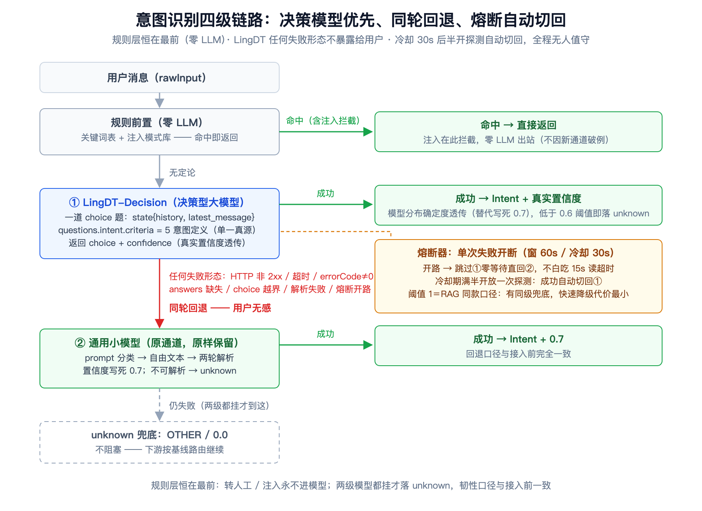
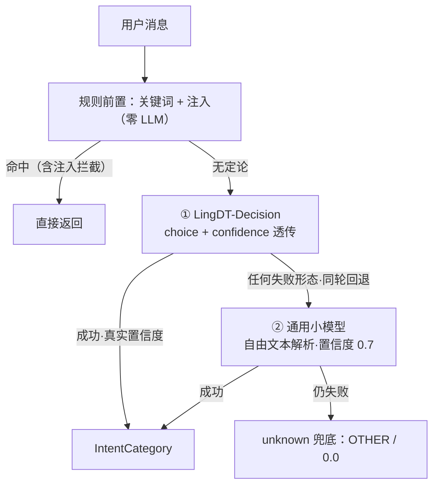
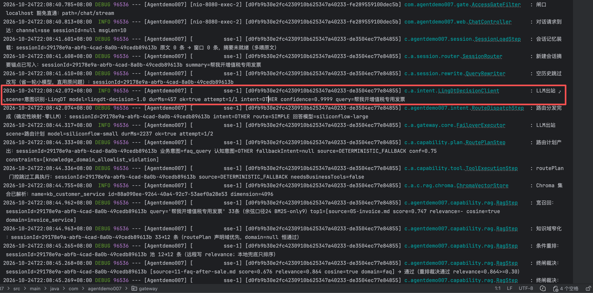
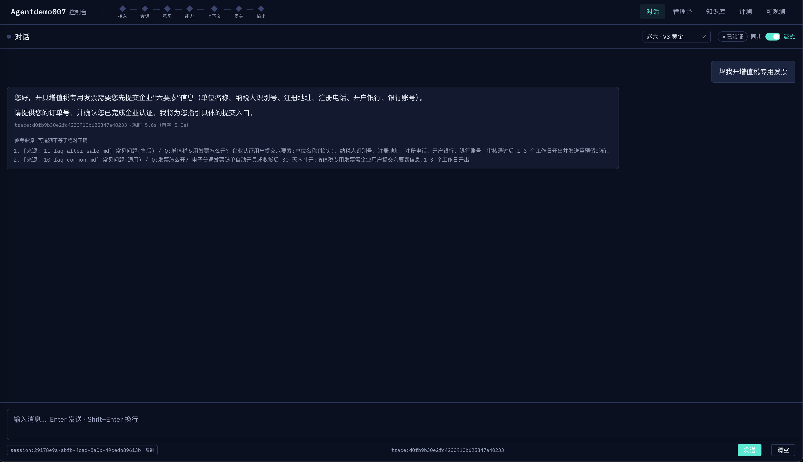
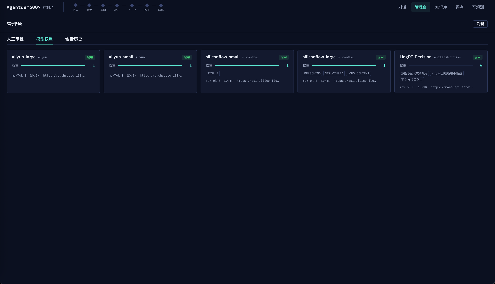
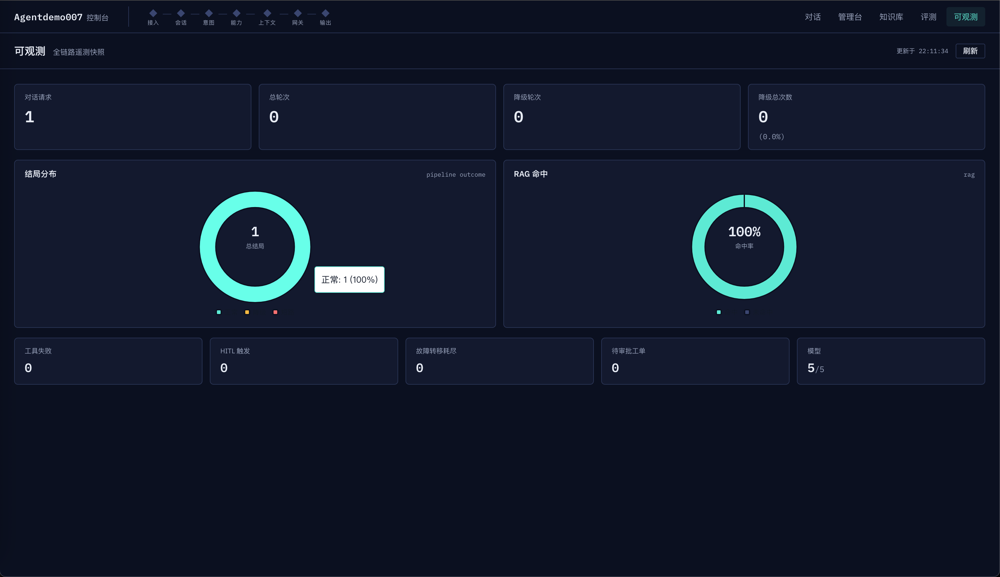

# 意图识别换发动机：决策型大模型 LingDT-Decision 接入实录——choice 决策、同轮回退与一个被文档写错位置的 model 字段

> **语言 / Language**：中文 ｜ 系列第十四章（[目录](https://blog.csdn.net/qq_24993561/article/details/166257230)）｜ 上一章：[链路可视化：OpenTelemetry 埋点与 Jaeger](https://blog.csdn.net/qq_24993561/article/details/167283735)
>
> **项目**：Agentdemo007 —— 电商智能客服 Agent
> **源码**：[github.com/Gavincui123/Agentdemo007](https://github.com/Gavincui123/Agentdemo007)
> **技术栈**：LingDT-Decision（蚂蚁数科 DTMaaS System One 决策 API，专有形态非 OpenAI 兼容）/ RestTemplate 专用出站（5s/15s 超时预算）/ CircuitBreakerGuard 熔断（阈值 1）/ OTel CLIENT span（复用第十三章拦截器）
> **周期**：2026-10-24 一日内：设计 → 实现 → curl 冒烟纠偏 → 重打包 → 本地全链路 → 生产部署验证
> **验证规模**：新增 15 个单测（client 9 + 识别器 4 + 可见性补录 2）+ 全量回归 1393 绿；本地真实出站首验 611ms / ok=true；生产公网真实消息端到端 6.2s 正常回复带引用、degraded=false，出站日志确认 `ok=true`（durMs=255）

---

## 核心结论

意图识别的 LLM 分类层换了一台「专用发动机」：原来是通用小模型做自由文本分类——发一段提示词、收回一行字、再自己解析；现在换成决策型大模型 LingDT-Decision（蚂蚁数科 DTMaaS System One），把意图分类建模成一道 **choice 题**：`state` 里放会话背景与最新消息，`criteria` 里放五个意图的一句话定义，模型直接返回选中的意图名和**它自己算出的置信度**。工程上四件事值得记：①**决策 API 与生成 API 的分界**——`choice + probabilities + confidence` 是原生结构化输出，解析层从「两轮字符串匹配兜底」缩成「严格候选集校验」，写死的 0.7 置信度换成模型真实分布确定度，下游 0.6 闸门第一次吃到真实输入；②**兜底是本章的主角**：LingDT 任何失败形态**同轮回退**通用小模型（用户无感）、单次失败熔断后**零等待直回**（不白吃 15s 读超时）、冷却 30s 半开探测**自动切回**——不可用自动切走、恢复自动切回，全程无人值守；③**文档把 model 字段的位置写错了方向**——按文档示例放 URL query，网关回 `missing_model`；真实位置是请求体顶层。这个错是拿真实凭据 curl 冒烟在**构建生产镜像之前**抓住的，而它最危险的地方在于：**兜底做得越好，接入错误藏得越深**——那版镜像若上了生产，系统一切正常、LingDT 永远 400，功能「上线了但没上线」；④**默认关闭零破坏**：`lingdt.enabled=false`（默认）时 client 不装配，链路与接入前逐字节一致，1393 全量回归绿。

## 一、为什么要换：自由文本分类的三个老毛病

先回顾换之前的样子。意图识别是三层结构（第二~三章）：规则前置（关键词表 + 注入模式库，零 LLM）→ 小模型分类 → unknown 兜底。小模型通道的做法是「提示词工程」：`buildClassifyPrompt` 把候选意图、分类原则、few-shot 示例、输出格式约束、会话背景拼成一大段提示词，发给通用小模型，收回一行字，再自己解析。

```java
// intent/IntentRecognizerImpl.java:117（原通道，接入后原样保留为回退层）
return """
        你是电商客服系统的意图分类器。任务：判断【用户最新问题】属于哪个意图类别。
        ## 分类原则 … ## 候选意图（名称(定义)） … ## 示例（问题 → 意图） …
        ## 输出格式
        只输出一行意图名（大写英文，如 CHIT_CHAT），不要输出任何解释、标点或其他内容。
        ## 会话背景（仅供理解指代与省略，分类只针对最新问题）
        %s
        用户最新问题：%s""".formatted(candidates(), transcript, query);
```

这套做法跑了很久，但一直有三个老毛病，全部源于一个事实：**它是拿「生成任务」凑合做「判断任务」**。

**毛病一：输出是自由文本，解析是概率性的。** `parseIntent` 靠两轮字符串匹配（枚举名全等 → 描述 contains），模型多吐一个标点、一句「好的，意图是」，这轮识别就白做、落 unknown。「只输出一行」的格式约束 + few-shot 压着，但约束是概率性的——第八章修意图漂移时就写过：prompt 修复是概率性的，部署后必须 `/eval/run` 见绿加线上复验，不能当确定性修复用。

**毛病二：置信度写死 0.7。** 小模型不返回置信度，代码里 `MODEL_CONFIDENCE = 0.7` 写死。下游 `IntentClassifier` 有道 0.6 的放行闸门（低于则兜底 UNKNOWN）——写死的 0.7 永远过线，这道闸门对模型通道形同虚设。「模型自己有多确定」这个信息在链路里根本不存在。

**毛病三：临界意图本质是分布问题，自由文本给不了分布。** 「退款流程是什么」是咨询、「我要退款」是办理——2026-09-28 的线上事故就是这对临界意图误判后三轮缠绕（eval 补了 rte-007/008 金丝雀钉住）。通用模型只给一个答案不给把握，工程上只能靠对照示例硬拉边界。

决策型大模型（LingDT-Decision）正好是冲着这类任务来的：**把「在给定选项中选一个 + 给出分布」做成 API 的一等公民**。选项集合是请求的一部分（模型不会输出候选之外的词）、全分布 `probabilities` 和对齐过的 `confidence` 是响应的一部分。三个毛病对着下药：

| 维度 | ② 通用小模型（原通道，保留为回退层） | ① LingDT-Decision（新通道） |
|---|---|---|
| 任务形态 | 提示词工程：候选 + 示例 + 输出格式约束 | 声明式：state + criteria，选项即契约 |
| 输出 | 自由文本一行 | `choice + probabilities + confidence` |
| 解析 | 两轮字符串匹配，失败丢 unknown | 严格候选集校验，越界即拒绝 |
| 置信度 | 写死 0.7 | 模型分布确定度透传 |
| 越界可能 | 可能吐解释/标点/候选外文本 | choice 越界 → 拒绝 → 同轮回退，不进结果 |

也要把边界说清楚：它不是「更强的通用模型」，是「另一类模型」。`decide` 还有三个调用方——查询改写、路由计划、画像提议——都是自由文本生成任务，choice API 表达不了。所以这次**只切意图识别一层**，其余不动。

## 二、把意图分类建模成一道 choice 题

System One 的请求形态（示意，字段名为真实口径）：`state` 放事实、`questions` 放问题，意图分类建模为 `intent` 一道 choice 型问题：

```json
{
  "model": "lingdt-decision-1.0",
  "state": {
    "history": ["[用户] 你好", "[助手] 您好，请问有什么可以帮您"],
    "latest_message": "这双鞋的材质透气吗，夏天穿热不热"
  },
  "questions": {
    "intent": {
      "type": "choice",
      "instructions": ["（四条分类原则，见下文）"],
      "criteria": {
        "CHIT_CHAT": "闲聊：问候、寒暄、情绪表达、与业务无关的闲谈",
        "REASONING": "推理：需要计算、对比、分析、总结或解释因果的问题",
        "LONG_CONTEXT": "长上下文：用户提供大段材料并要求基于材料处理",
        "STRUCTURED_EXTRACTION": "结构化抽取：从用户给定的文本中提取字段或结构化信息",
        "OTHER": "其他：咨询、办理、投诉等业务诉求，且不属于以上任何类别"
      }
    }
  }
}
```

响应同样是结构化的（冒烟实测同构）：`errorCode=0` 即成功，答案在 `answers.intent` 下，`confidence` 是模型对分布确定度的对齐值。有个耐人寻味的细节：`output_tokens: 0`——决策不生成文本，没有 token 流，就是算一个分布出来。

```json
{
  "model": "lingdt",
  "answers": {
    "intent": { "type": "choice", "choice": "OTHER",
                "probabilities": {"OTHER": 0.9895}, "confidence": 0.9895 }
  },
  "usage": { "input_tokens": 96, "output_tokens": 0 },
  "errorCode": 0
}
```

组装代码里有两个坚持值得展开。

**坚持一：criteria 不另维护词表，`MODEL_CANDIDATES` 单一真源。** 通用通道的候选清单（提示词里那段）和新通道的 criteria（请求体里这个 map）必须是同一份东西，否则迟早出现「两套候选各改各的」。做法是把 `MODEL_CANDIDATES` 从 private 提为包级可见，client 直接拿它组装 criteria——新增意图只改一处，两个通道同时生效：

```java
// intent/LingDtDecisionClient.java:108 —— criteria 即候选意图定义，单一真源
Map<String, String> criteria = new LinkedHashMap<>();
IntentRecognizerImpl.MODEL_CANDIDATES.forEach((intent, definition) ->
        criteria.put(intent.name(), definition));
```

顺带这里藏着第二章的一个历史教训：候选里**没有** `TRANSFER_TO_HUMAN`（转人工）和 `INJECTION`（注入）。前者是实测踩过的意图漂移——模型把「帮我开增值税专用发票」判成转人工，业务问题被建工单话术劫持，所以转人工收归关键词层（显式诉求才触发，0.95）；注入更是在规则层零 LLM 拦截，根本不该进任何模型。新通道沿用同一候选集，response 校验也按它做白名单——`choice` 越界（比如模型吐了个 `TRANSFER_TO_HUMAN`）直接拒绝进回退，**规则层独占的意图在新通道天然不可达**。

**坚持二：分类原则与通用通道同源。** `instructions` 四条——结合 history 消解指代、只依据显式诉求（不因「系统能否办理」改判）、转人工不在候选、拿不准选 OTHER——就是原提示词「分类原则」一节的声明式重述。会话背景 `state.history` 也是同一口径：近 6 条 `[角色] content`（分类只需近期指代线索，长历史稀释注意力），连角色标签函数 `label()` 都是复用的。**换通道不换任务定义**——意图体系是业务资产，通道只是执行器。

规格余量顺带一提：单请求上限 32 个问题、每题 255 个选项、16K token——我们用了 1 题 5 选项。这套 API 的设计场景是「把一批业务判断题塞给模型批量决策」，本次只用了它规格的一角。

## 三、冒烟实测：文档让我把 model 放错地方

接入流程走的是标准三步：读官方文档 → 实现 + 单测绿 → curl 冒烟。第三步抓出了大问题。

按文档示例，模型路由名 `model` 放在 URL query（`POST {endpoint}?model=lingdt-decision-1.0`）。冒烟第一发，网关回业务错误：`missing_model`，errorDesc 大意是 **"Missing Model: model field not found in request body"**。错误信息其实已经把答案说出来了——`in request body`——但文档通篇没有一句话写明 model 必须放**请求体顶层**。把它从 URL 挪进 body，同凭据同参数再发：`errorCode=0`，`choice=OTHER`，`confidence=0.9895`（问的是一句商品材质咨询，OTHER 正确）。

修正落进代码就是一行的事——`buildBody` 顶层放 `model`，URL 用裸 endpoint：

```java
// intent/LingDtDecisionClient.java:112 —— model 在 body 顶层（实测网关口径，URL query 不认）
Map<String, Object> body = new LinkedHashMap<>();
body.put("model", props.getModel());
body.put("state", state);
body.put("questions", Map.of(QUESTION_ID, question));
```

单测断言同步改：URL 等于裸 endpoint（无 query）、请求体 contains `"model":"lingdt-decision-1.0-27b"`（`-27b` 是测试夹具里的路由名，非生产值）。

这个坑值得单独写一节，不是因为多难修，而是因为**它差点以最安静的方式溜进生产**。推演一下：如果不做冒烟、第一版镜像（URL query 版）直接构建上生产，会发生什么——每轮意图识别 LingDT 返回 400 → 同轮回退通用小模型 → 意图识别照样成功 → 用户无感、接口正常、`degraded=false`（意图识别层没有降级语义）。**功能等于没上线，而系统看起来完全健康。** 唯一的暴露口是「LLM出站 scene=意图识别·LingDT ok=false」日志和 /obs 台的模型成功率曲线。

这就是本章最想记住的教训：**兜底做得越好，接入错误藏得越深。** 回退通道是给「LingDT 宕机」设计的韧性机制，它顺带把「我接错了」也一并兜住了——两种根因，同一种安静。所以接入带兜底的外部依赖，上线验收的标准不是「接口能用」（回退会让它永远「能用」），而是**「出站日志见 ok=true」**；冒烟必须发生在构建生产镜像之前，且要用真实凭据对着真实网关打——这类「文档与实现有出入」的错，mock 测试永远测不出来。

## 四、兜底设计：同轮回退、熔断零等待、半开自动切回

需求一句话：决策型大模型不可用时，自动切换回通用大模型做意图识别，需要兼容。设计答案是三件事叠加：**不可用 → 切走（用户无感）；宕机期 → 不反复试（零等待）；恢复 → 自动切回（无人值守）**。

升级后的完整链路：





**同轮回退：不是「下一轮换通道」，是「这一轮就地降级」。** 识别器里 ①②是同一次 `recognize` 调用里的两步：①抛任何异常，catch 住打一条 WARN，紧接着走②把本轮分类做完。用户这轮照样拿到意图结果，多付的延迟只有①那次失败调用的时间（且有 5s/15s 超时预算封顶）：

```java
// intent/IntentRecognizerImpl.java:77 —— ①任何失败形态，同轮回退②，用户无感
if (lingDt != null) {
    try {
        LingDtDecisionClient.Decision decision = lingDt.classify(classifyQuery, history);
        return new IntentCategory(decision.intent(), decision.confidence());
    } catch (Exception e) {
        log.warn("意图识别LingDT不可用，本轮回退通用小模型：reason={}", e.getMessage());
    }
}
// 2b. 通用小模型分类（原通道，LingDT 未启用/不可用时的兜底——行为与接入前完全一致）
String prompt = buildClassifyPrompt(classifyQuery, history);
String reply = llm.decide(prompt, "意图识别");
```

「任何失败形态」的清单由 client 的校验链定义（顺序对齐官方文档 §4.2）：HTTP 非 2xx、连接失败/超时、`errorCode≠0`、`answers` 缺失或类型不符、choice 越界候选集、confidence 越界 [0,1]、JSON 不可解析——每一环失败都抛 `IllegalStateException`，在识别器里就是同一条回退路径。

**熔断：解决「宕机期每轮白试一次」。** 只有同轮回退还不够——若 LingDT 整体宕机，每轮意图识别都要先吃一次失败才回退：运气好是连接拒绝（毫秒级），运气差是读超时（15s 白等）。client 里包了一层项目既有的 `CircuitBreakerGuard`（RAG 嵌入/重排通道同款），**单次失败即开断**：开路期间 `classify` 不发起 HTTP 直接抛，识别器零等待走②。

```java
// capability/rag/CircuitBreakerGuard.java:36（既有类，本章第 4 个使用方）
public <T> T call(Supplier<T> action) {
    if (!breaker.allow(key)) {
        throw new IllegalStateException(
                channelName + " 熔断开启中（近期连续失败，快速走兜底通道）");
    }
    try {
        T result = action.get();
        breaker.recordSuccess(key);   // 成功关断路器
        return result;
    } catch (RuntimeException e) {
        breaker.recordFailure(key);   // 失败计数
        throw e;
    }
}
```

参数定案：窗口 60s / **阈值 1** / 冷却 30s。阈值 1 是刻意选的，放进第三章的熔断阈值光谱就看清了：

| 通道 | 开断阈值 | 理由 |
|---|---|---|
| 模型级（主链路 LLM） | 5 次 | 误熔断触发主备切换、影响终答质量，代价高，宁可多试几次 |
| 工具级（per-tool） | 3 次 | 工具失败有自纠正重试兜底 |
| RAG 稠密/重排 | 1 次 | 本地 BM25 基线恒在，单次失败快速降级代价最小 |
| 画像读路径 | 1 次 | 无画像照常答 |
| **LingDT（本章新增）** | **1 次** | **通用小模型是同级兜底——切走 ≈ 回到接入前，快速降级近似零代价** |

判据始终是那一句：**兜底通道的质量决定阈值的位置**。LingDT 的兜底（通用小模型）就是接入前的全部生产能力，质量同级——误熔断 30s 的代价只是「这段时间用原通道」，而漏熔断的代价是每轮白等一次超时。这笔账怎么算都是阈值 1。

**自动切回：冷却 30s 后半开放行一次探测。** 探测请求成功即 `recordSuccess` 关断路器（回到①），失败继续开路。LingDT 从故障恢复的瞬间，最多再等 30s 就自动回归决策通道——无需人工干预、无需重启、无需改配置。这条行为有专门的单测钉着（冷却期注入 50ms）：

```java
// intent/LingDtDecisionClientTest.java:174 —— 半开探测成功，自动切回
assertThatThrownBy(() -> client.classify("q1", List.of())).hasMessageContaining("连接失败/超时");
Thread.sleep(120); // 过冷却期
LingDtDecisionClient.Decision d = client.classify("q2", List.of());
assertThat(d.intent()).isEqualTo(Intent.OTHER); // 半开探测成功，自动恢复
```

最后一个语义细节：**置信度口径在两条通道上刻意不同**。①透传模型真实 confidence（可能是 0.99，也可能是 0.55）；②维持写死 0.7（「可达阈值」的工程近似，第八章以来的口径不动）。这带来一个以前不可能出现、现在恰恰符合预期的行为：**LingDT 自己说没把握（confidence < 0.6）时，这轮意图会被 IntentClassifier 的闸门兜成 UNKNOWN**——模型有把握就放行，没把握就落基线，闸门第一次吃到真实输入，而不是恒过线的 0.7。

## 五、装配与零破坏：默认关、null 注入、双构造器

兼容性的最后一层在装配。`lingdt.enabled` 默认 false——不配置时 client bean 根本不存在，识别器的 `lingDt` 字段是 null，走原 2b 通道，行为与接入前**逐字节一致**（这也是全量回归敢跑的底气）：

```java
// intent/IntentConfig.java:125 —— ObjectProvider：未启用时 null 注入，链路=现状
@Bean
IntentRecognizer intentRecognizer(RuleMatcher ruleMatcher, ChatLlmService llm,
                                  ObjectProvider<LingDtDecisionClient> lingDt) {
    return new IntentRecognizerImpl(ruleMatcher, llm, lingDt.getIfAvailable());
}

@Bean
@ConditionalOnProperty(name = "lingdt.enabled", havingValue = "true")
LingDtDecisionClient lingDtDecisionClient(LingDtProperties props, AgentMetrics metrics,
        ObjectProvider<AgentTracer> tracer, ObjectProvider<OpenTelemetry> openTelemetry,
        ObjectProvider<ObjectMapper> objectMapper) {
    RestTemplate rt = LingDtDecisionClient.restTemplate(props);   // 5s/15s 超时预算
    rt.getInterceptors().add(new TraceClientInterceptor(          // OTel CLIENT span
            tracer.getIfAvailable(() -> AgentTracer.NO_OP),
            openTelemetry.getIfAvailable(OpenTelemetry::noop)));
    log.info("LingDT-Decision 决策型大模型已启用（意图识别优先通道，不可用自动回退通用小模型）："
            + "model={} endpoint={}", props.getModel(), props.getEndpoint());
    return new LingDtDecisionClient(props, rt,
            objectMapper.getIfAvailable(() -> JsonMapper.builder().build()), metrics);
}
```

几个细节各有出处。**双构造器**：两参构造器委托三参（`lingDt=null`），既有测试与未知调用方零感知。**专用 RestTemplate 静态工厂**：Boot 4 的 Framework 7 已移除 `RestTemplateBuilder`（第十三章坑 3），手建 `new RestTemplate(factory)` 必须显式给超时——裸 RestTemplate 无超时会无限挂起，这是第八章 80.5s 事故的镜像教训；5s/15s 对齐 embedding/chroma 惯例，决策调用实测秒级，15s 是充分余量。**`ObjectProvider` 三连**：tracer / openTelemetry / objectMapper 都按「缺省降级 no-op」注入——迷你上下文里没有 OTel bean 时装配照常，不炸。

配置三处落位，口径与 `SF_KEY`/`ALIYUN_KEY` 惯例一致（密钥走 env 占位，不落 Nacos 明文——生产实际填法见第七节欠账）：

```yaml
# application.yml:197 —— lingdt 配置段（env 占位，默认关）
lingdt:
  enabled: ${LINGDT_ENABLED:false}
  endpoint: ${LINGDT_ENDPOINT:}
  model: ${LINGDT_MODEL:}
  api-key: ${LINGDT_API_KEY:}
  connect-timeout-ms: ${LINGDT_CONNECT_TIMEOUT_MS:5000}
  read-timeout-ms: ${LINGDT_READ_TIMEOUT_MS:15000}
```

测试矩阵 15 个新用例，三层各钉各的——client 层钉「出站与校验」（请求组装：URL 无 query、body 顶层 model、criteria 全集、不含规则层独占意图；校验链：errorCode≠0 / choice 越界 / confidence 越界 / HTTP 401 / 连接失败 / 不可解析各自拒绝；熔断：单次失败开断后 `verify(rt, times(1))` 零再发 HTTP、半开恢复），识别器层钉「编排语义」（成功用真实置信度且不触达②、失败同轮回退、双挂落 unknown、规则层命中①零调用），可见性补录层钉「新通道看得见」（权重页追加合成条目、obs 计数 +1）。分层的好处是识别器测试不用关心 HTTP 形态，client 测试不用关心回退编排，**每层钉住自己那半不变式**。全量回归 1393 绿（上一基线 1378 + 15）。

## 六、可观测与验证：从单测到公网

可观测三件套全部复用既有出口，不新开信道：

- **日志**：出站行与网关 `FailoverExecutor` 同款格式，并在截图评审后补强为「出站行自身即证据」——成功行形如 `LLM出站 scene=意图识别·LingDT model=lingdt-decision-1.0 durMs=255 ok=true attempt=1/1 intent=OTHER confidence=0.99 query=这双鞋的材质透气吗…`（决策结论 + 问题摘录直接可复核，不用回翻上游），失败行带 `err=` 原因；降级时另有 WARN `意图识别LingDT不可用，本轮回退通用小模型：reason=...`。grep「LLM出站」一个关键字，两代通道一起查——**第三节说的「接入错误唯一暴露口」就是这几行日志，所以它们必须一眼能读出结论**。
- **指标**：`recordModelCall(millis, ok)` 与模型网关同源埋点。但同源也意味着同口径：这组指标（`agent.gateway.calls` 成败计数 + `agent.gateway.call.duration` 耗时 Timer）**没有 model 维度标签**，是全通道混计的全局值；/obs 页的「模型 x/y」是计数信号，不是按模型的健康格。也就是说「LingDT 单独的成功率」当前查不出来——全局值看趋势，精确归因靠日志行，这也是出站行补强成「自带决策结论」的另一半理由（指标加 model 标签的欠账第七节记了）。评审收口后又补了半句诚实账：指标在 `classify` 层统一记，**熔断开路的零等待快速失败同样计败**——通道全挂时全局成功率会真实掉下来，而不是因为「没出站」显得一切正常。
- **span**：RestTemplate 挂第十三章的 `TraceClientInterceptor`，Jaeger 里意图识别出站是一条 `HTTP POST` CLIENT span（带 url/状态码属性），与 15 步流水线同 traceId。

验证爬了四级楼梯，每一级钉的东西不同：

1. **单测**（1393 绿）：钉形态与编排不变式，如上节。
2. **本地真实出站**：env 注入三要素起应用，真实消息过流水线——出站日志 `durMs=611 ok=true`，意图 OTHER（正确），**同轮零通用模型调用**（①成功②不触达）。
3. **生产部署**：Nacos dataId 补 lingdt 三要素真值 + `.env` 加 `LINGDT_ENABLED=true` → 镜像 save/scp/load → `up -d` 重建（env 变更 `restart` 无效，第十二章的坑，必须 `up -d`）。
4. **公网端到端**：带访问码发真实消息「这双鞋的材质透气吗，夏天穿热不热」——code=0 正常回复、带 RAG 引用、`degraded=false`、总耗时 6.2s。意图层是否真走了 LingDT，以容器日志的「已启用」装配行与 `ok=true` 出站行为准（第三节的教训：接口能用不等于通道在跑）——生产实测出站行 `durMs=255 ok=true`，且打在 sse- 流式线程上、traceId/spanId 齐（第十三章的 SSE 上下文搬运在这条链路同验）。255ms 比本地首验的 611ms 更快——生产网络到网关更顺，意图层开销对总延迟的影响可以忽略。

**上线后截图评审又揪出两处，同晚补强**（「全绿 ≠ 无缺陷」的又一次应验，这次出自自己截的图）：

- **模型权重页与 /obs 台「模型 4/4」看不见 LingDT**——决策通道当时刻意不进网关注册表（非 OpenAI 兼容，进了会被 ModelRouter 当生成模型路由选中），但「不进注册表」被顺带做成了「不可见」，管理台完全看不出这条新通道的存在。补法：两个读出口补录——`/admin/models` 在 `lingdt.enabled=true` 时末尾追加一条合成条目（weight=0、tags 标注「意图识别·决策专用／不参与权重路由／不可用回退通用小模型」，前端零改动即渲染）；`/api/obs/summary` 的模型总数/启用数各 +1。注册表本身一个字节不动，路由语义零变化。
- **出站行信息量不够**——`durMs=255 ok=true` 只证明「调用了、成功了」，不证明「分类对了」。补强后成功行带 `intent=/confidence=/query=`，截图即证据。

**本地全链路复验的四张实测图**（补强打包后重跑；复验特意挑了第二章意图漂移事故的原句「帮我开增值税专用发票」——当年通用通道把这句业务咨询误判成转人工、被建工单话术劫持；决策通道下 LingDT 给出 `intent=OTHER confidence=0.9999`，下游业务意图层收敛到 faq_query，带着两份发票 FAQ 引用正常出口）：









## 七、欠账与边界

- **api-key 明文落在 Nacos dataId**：与 `SF_KEY`/`ALIYUN_KEY` 的 env 占位惯例不一致（`deploy/.env.prod.example` 已备 `LINGDT_API_KEY=__CHANGE_ME__` 模板）。属涉密口径欠账，待收口为 `${LINGDT_API_KEY}` 占位 + 服务器 env 注入。
- **`/eval/run` 黄金集复验未做**：第九章口径——prompt 修复是概率性的，**换意图通道同理**。rte-007/008（退款咨询 vs 办理）与 rag-008 金丝雀应在 LingDT 通道下重跑见绿，才算效果侧收口（本章收的是行为侧：回退、熔断、恢复均已实测）。
- **probabilities 未用**：只取了 confidence，全分布（五个意图各自的概率）在手里没用上。二期方向：低置信时把分布交给会话仲裁器做「追问澄清」的输入（第六章仲裁器的输入 +1）。
- **模型指标没有 model 维度**：`recordModelCall` 的成败/时长是全通道混计的全局值（第六节的诚实口径），LingDT 单独的成功率出不了曲线，归因靠日志行。若后续要按模型出健康曲线，得给这组指标加 model 标签——代价是标签基数随模型数增长，加之前要掂量 Micrometer 的 cardinality。
- **熔断阈值 1 偏敏感**：单次网络抖动就切走 30s。接受理由是回退通道质量同级、切走代价 ≈ 0；若后续量化发现 LingDT 质量显著占优，再调 2~3 并同步评估冷却期。
- **LingDT 无主备**：DTMaaS 只此一家、单 endpoint，没有 `llm.providers` 那样的多供应商路由。熔断 + 回退就是它的全部韧性策略——好在兜底是自己的通用小模型通道，不依赖同一家服务商。
- **决策 API 覆盖边界重申**：改写/路由计划/画像提议仍是生成任务，choice API 表达不了。「决策型」不是「更强」，是「另一类」——别把生成任务硬塞给它。

---

*时间线：2026-10-24 上午方案设计与实现（client/识别器/装配/13 单测）→ 中午 curl 冒烟发现 model 字段位置、修 client + 断言 + 重打包 → 下午本地全链路（611ms ok=true、同轮零通用模型调用）→ 晚 Nacos 补真值 + 生产 `up -d` + 公网端到端验证（6.2s 正常回复带引用、degraded=false，出站 255ms ok=true）→ 同晚截图评审揪出模型页/obs 不可见与日志信息量两处，补录 2 单测后重打包（1393 绿）。*

---

*本文机制出处：`intent/LingDtDecisionClient`（System One 出站、校验链、熔断包裹、指标与出站日志）、`intent/LingDtProperties`（lingdt.* 配置）、`intent/IntentRecognizerImpl`（四级链路与同轮回退、MODEL_CANDIDATES 单一真源）、`intent/IntentConfig`（@ConditionalOnProperty 条件装配 + ObjectProvider null 注入 + 专用 RestTemplate）、`capability/rag/CircuitBreakerGuard`（复用熔断守卫，第 4 个使用方）、`admin/AdminModelController` 与 `observability/ObservabilitySummaryCollector`（决策通道可见性补录：权重页合成条目 + obs 计数）、`observability/trace/TraceClientInterceptor`（OTel CLIENT span，第十三章产出）；配置出处 `application.yml` lingdt 段、`deploy/.env.prod.example`、`DEPLOY.md` §6.5（Nacos dataId 模板与发布清单）。*

> 相关阅读：[系列目录](https://blog.csdn.net/qq_24993561/article/details/166257230) · [上一章：链路可视化](https://blog.csdn.net/qq_24993561/article/details/167283735) · [第三章·模型网关与韧性治理（熔断阈值光谱出处）](https://blog.csdn.net/qq_24993561/article/details/166257763) · [第二章·提示词工程体系（MODEL_CANDIDATES 与候选排除的历史事故）](https://blog.csdn.net/qq_24993561/article/details/166257780) · [第八章·全链路调优（意图漂移与超时预算）](https://blog.csdn.net/qq_24993561/article/details/166257713) · [第九章·评测体系（「prompt 修复是概率性的」口径）](https://blog.csdn.net/qq_24993561/article/details/166257751)
