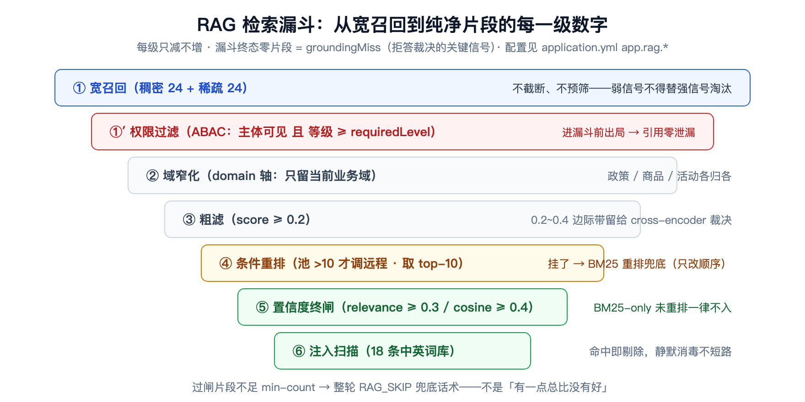
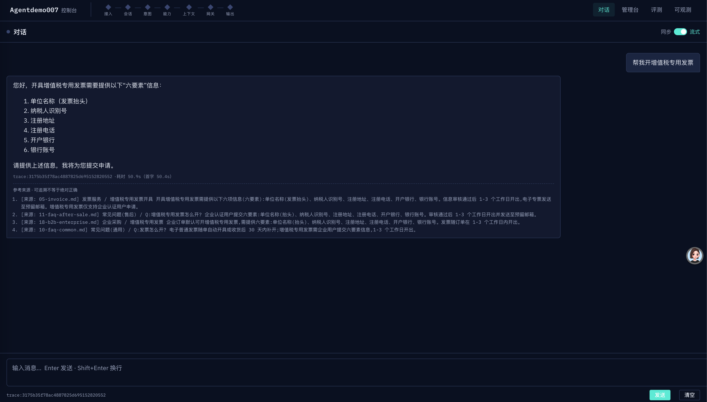
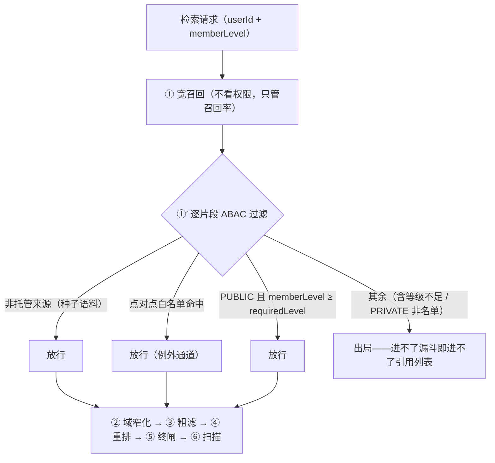

# 检索侧演进：从「能搜到」到「敢引用」——Hybrid 融合、时效治理、知识分级与拒答

> **语言 / Language**：中文 ｜ 系列第五章（[目录](https://blog.csdn.net/qq_24993561/article/details/166257230)）｜ 上一章：[会话记忆分层](https://blog.csdn.net/qq_24993561/article/details/166257790)
>
> **项目**：Agentdemo007 —— 电商智能客服 Agent
> **技术栈**：Java 17 / LangChain4j / Chroma（稠密向量）+ Lucene（磁盘倒排稀疏）+ SiliconFlow 嵌入/重排（Qwen3-Embedding-8B，4096 维）
> **周期**：2026-09-17（Hybrid + 时效）→ 09-19（拒答 + 知识库在线录入）→ 09-20（知识分级 ABAC，Phase 21）+ 红队毒片实验
> **验证规模**：Phase 20 交付 594 全绿 → 拒答+录入交付 1213 全绿（11 新测试类 56 例）→ Phase 21 交付 1270 全绿，红队 3 毒片实测
> **源码**：[github.com/Gavincui123/Agentdemo007](https://github.com/Gavincui123/Agentdemo007)

---

## 核心结论

检索侧的三轮升级，没有一轮是提前规划出来的，每一轮都是被一个真实缺陷逼出来的。最早我也以为 RAG 就是"调一次向量库"，直到拿"ORD-001 怎么开发票"去测——什么都没搜回来。订单号词面精确、语义模糊，纯向量必然漂移，这才补了 BM25 稀疏通道做双路融合。

接着是已下架的旧退款政策冒充现行政策混进回答：历史片段与现行片段在检索眼里毫无区分，时效治理因此上马。第三轮最扎心——V1 客户能搜到 V3 专属政策，检索根本没有权限维度，Phase 21 的 ABAC（基于属性的访问控制：按客户等级划定知识可见档位）知识分级就是被这一票逼出来的。

而"知识库里没有的内容模型自己编"，检索自身堵不住，需要的是一个独立的拒答闸门。最后红队的三片毒文档给我算了一笔清醒的账：防线防得住注入话术，防不住"像真的的错误"——这笔欠账我明示在案，不装作防住了。三次交付的测试计数从 594 涨到 1213 再到 1270，全绿。

## 一、漏斗全景：每一级都有数字

把检索当产品打磨，是从承认一件事开始的：它不是"调一次向量库"，而是一个七段漏斗。每一段都对应一类我在测试里真撞见过的问题：宽召回 24+24（稠密、稀疏两路各 24 条）保证召回率，权限过滤把无权片段挡在门外，域窄化砍掉不相关业务域，0.2 的粗滤线先删掉一眼假的，条件重排只留 top-10，置信度终闸做最终裁决，注入扫描收尾。这些数字全部是配置常量（`app.rag.*`），不是拍脑袋——调参的时候每一个都有名字。



漏斗有一个总的裁决原则，写在 `RagStep` 的 javadoc 里：**低置信知识绝不进 LLM**。每一级的失败都有明确去向——终闸不过 → `RAG_SKIP` 话术；注入扫描清空 → `RAG_SKIP`；而"漏斗终态零片段"这个事实本身会被记成 `groundingMiss`，成为拒答裁决的关键信号。这是 §七 的伏笔，先按下不表。

漏斗的最终产物长这样：回答自带来源列表（每条可对照原文）和「可追溯不等于绝对正确」的声明——"敢引用"不是口号，是用户每轮都能看到的东西（截图为延迟调优前）：



## 二、精确词为什么必须有稀疏通道

稀疏通道的由来，要从一个搜不到的订单号讲起。"ORD-001"在向量空间里和"ORD-002"几乎重合，和"订单一号"可能更近——语义相似不等于标识符精确，订单号、商品型号、发票类型这类词面精确、语义模糊的 token，必须走词面匹配。

直觉做法是另造一套"精确词标记"：给这类 token 打标、建专门通道。我最终选了最克制的形态——什么新机制都不加，让 **BM25 的高 IDF 自然上浮**稀有词。IDF 本身就是"稀有程度"的度量，机制现成，何必再造。`HybridRetriever` 的融合规则三句话：稀疏命中优先置顶、稠密补齐、按文本去重：

```java
// capability/rag/HybridRetriever.java —— 双通道融合
public static List<RagFragment> fuseChannels(List<RagFragment> dense, List<RagFragment> sparse, int cap) {
    Map<String, RagFragment> denseByText = new HashMap<>();
    for (RagFragment f : dense) {
        denseByText.putIfAbsent(textKey(f), f);
    }
    LinkedHashSet<String> seen = new LinkedHashSet<>();
    List<RagFragment> fused = new ArrayList<>();
    for (RagFragment f : sparse) {       // 稀疏优先置顶（提权）；同文本取稠密副本（余弦口径）
        String key = textKey(f);
        RagFragment chosen = denseByText.getOrDefault(key, f);
        if (seen.add(key)) {
            fused.add(chosen);
        }
    }
    for (RagFragment f : dense) {        // 稠密补齐（稀疏未覆盖的语义命中）
        if (seen.add(textKey(f))) {
            fused.add(f);
        }
    }
    // …cap 截断…
}
```

这段代码里有一个容易看漏的细节：**同文本双通道命中时保留稠密副本**。原因要往下看两级才明白——只有稠密副本带余弦口径，才过得了我后面设置的置信度终闸；仅稀疏命中的候选只有 BM25 词面分，口径未校准，不得凭它入上下文（§五）。

诚实记录一处设计与实现的偏差：Phase 20 规划的是「向量+关键词+规则路由」三通道三个独立类，落地时收敛为「Retriever seam + BM25 稀有词上浮」双通道——规则路由那一路被证明多余，砍掉了。规划文档留了偏差注记，这是刻意的：不记下来，三个月后读代码的人会以为实现漏了东西。

## 三、时效治理：过时不冒充当前

客服知识库有个别的领域没有的风险：政策会换代。去年的退款政策还躺在库里，语义相关性一点不低，甚至措辞更贴合老问题——对检索器来说它就是一条高分候选。所以时效治理要回答的问题是：过时片段怎么处理，才不会冒充当前。

我的第一反应是拿 `validUntil` 和当前时间比较，检索时动态判断。这条路被我否了：它给检索路径引入时钟依赖——测试要注入时钟，排序随时钟漂移，同一份语料昨天和今天可能给出不同结果。最后落成两层防线，全用确定性信号：

1. **隔离标注**：`temporalTag=HISTORICAL` 的片段在 `displayText()` 里强制加前缀"【历史参考资料·截至{date}】"——过时片段可以进上下文，但必须自报家门；
2. **重排衰减**：本地 BM25 重排对历史片段乘 `TEMPORAL_DECAY = 0.5`——同等相关性近期优先。

```java
// capability/rag/Bm25Reranker.java —— 时效衰减
for (int i = 0; i < n; i++) {
    double score = bm25(docTokens.get(i), uniqueQuery, df, n, avgdl);
    // Phase 20 时效衰减：历史片段降权，同等相关性近期优先（过时不冒充当前，§5.4.1）
    if (HISTORICAL_TAG.equals(candidates.get(i).temporalTag())) {
        score *= TEMPORAL_DECAY;
    }
    scores.add(score);
}
```

两个"为什么"值得记下来。**为什么用显式标签而不是拿 `validUntil` 和当前时间比较**——前者是语料入库时就定死的确定性信号，后者是随时钟漂移的活物，检索这种读侧路径经不起不确定性。**为什么远程重排不施加衰减**——真模型按语义相关性打分，优于任何启发式衰减；历史片段交给 `displayText()` 标注隔离就够了，一层防线上再叠一层启发式，只会造出解释不了的排序。

## 四、稀疏通道落库之战：Chroma 证伪与 Lucene 落盘

稀疏通道最初我想完全交给向量库——少一个组件，少一份运维。2026-09-17 我把这条路挨个方向试了一遍，**四条路实测全部堵死**（教程 FAQ 与代码注释均有记录）：

1. 带稀疏索引的集合创建被服务端拒绝："Sparse vector indexing is not enabled in local"；
2. 稀疏向量 metadata 写入被拒（服务端 `MetadataValue` 枚举不含 sparse_vector）；
3. `/search` 端点 1.0.8 返回 404，1.5.9 报 "not implemented for local executor"；
4. 即便上云，官方 BM25 分词器是英文口径——空白切分 + 英文停用词，600 字中文块会切出 0 个 token。

第四条最致命：前三条还能指望版本演进，分词器口径是产品决策，600 字中文块切出 0 个 token 意味着中文语料的稀疏索引只能自建。

落地方案是 Lucene 磁盘倒排。选型动机我写在了 `LuceneBm25IndexService` 的 javadoc 里："用户生产顾虑——单机服务器内存被中间件占用，**JVM 常驻全量语料过不了生产级**"。所以索引用 `MMapDirectory` 落盘、读走 OS 页缓存、堆内存 O(1)；BM25 用内置相似度（k1=1.2 / b=0.75，与项目自己的 `Bm25Reranker` 同参数，两套口径不打架）。

启动时从 Chroma 分页流式同步，chunkId 用 `sha256(text#source)` 与稠密库天然统一（幂等 upsert 不产生重复块）；同步失败**告警并保留现有磁盘索引继续服务**——检索侧组件挂一个，不能拖死启动。这套机制第六章已带过一笔，这里补全的是动机：不是我喜欢 Lucene，是被四路证伪逼的。

## 五、置信度终闸：BM25 分不能冒充语义置信度

终闸是检索的**最终动作**，不是诸多过滤器之一——它裁决的不是某个片段好不好，而是"这轮检索结果还配不配进 LLM"。双判据的裁决逻辑全部收在 `RetrievalValidator`：

```java
// capability/rag/RetrievalValidator.java —— 逐片段裁决
if (f.relevance() != null) {
    boolean passed = f.relevance() >= rerankMinScore;
    records.add(new GateRecord(f, passed, …));
} else if (!f.cosineScored()) {
    records.add(new GateRecord(f, false, "无余弦口径（BM25-only）未经理裁决，不得入上下文"));
} else if (f.score() >= minScore) {
    records.add(new GateRecord(f, true, …));
} else {
    records.add(new GateRecord(f, false, …));
}
```

三支判据：被远程重排过的片段看 `relevance`（重排模型的置信口径）；BM25-only 且无余弦口径的直接判负——淘汰原因就是源码里那行字符串；未重排但有余弦口径的看 `minScore`。

第三支是全漏斗里最"较真"的规则：**BM25-only 且未经重排的候选，一律不得入上下文**。BM25 高分只证明字面匹配——词频锤击都能刷高分，某片段反复重复查询词即可获得高余弦/高分，但它不能冒充语义置信度证据。所以规则是二选一：要么经远程重排凭 `relevance` 入内，要么淘汰，没有第三条路。

幸存片段数不足 `min-count` → 整轮 `RAG_SKIP` 兜底话术，而不是"有一点总比没有好"。检索层在这里的克制，是 §七 拒答机制的地基：检索自己都不确定的东西，就别往模型嘴里塞。

## 六、知识分级 ABAC：权限骑在文档属性上

### 6.1 三轴拆分

Phase 21 之前，检索对用户身份是完全盲的——任何会话查任何语料。给检索加权限维度，我最先想到的是最直觉的做法：建一张 namespace↔level 映射表，哪个分区对应哪个等级，查表即判。这张表在设计期被我专门"杀死"了：权限骑在容器上，"往哪个目录放"就变成了权限决策——默认放行是漏洞，默认拒绝是"传了搜不到"的对账成本。权限必须骑在**文档属性**上。

最终的三轴拆分长这样：

| 轴 | 字段 | 职责 |
|---|---|---|
| 领域轴 | `domain` | 业务/领域分类（路由用：域窄化那一级） |
| 安全轴 | `requiredLevel` | 客户等级可见性（V0~V5 六档） |
| 主体轴 | `namespace` | 内外边界与存放分区（PUBLIC/PRIVATE） |

三根轴各管一件事：领域轴服务路由，就是漏斗里域窄化那一级的依据；安全轴管"什么等级的客户能看"；主体轴管内外边界与存放分区。权限谓词一句话：**主体类型可见 且 主体等级 ≥ 文档要求等级**（点对点白名单为例外通道）。

等级红线是 Phase 21 自身设立、Phase 22 画像守门沿用并回归钉死的那一条：**等级来源只有登录态 + 会员服务，永不从对话内容取**。用户自称"我是 VIP"不采信——那等于给提示词注入开直通车；等级查询失败 fail-closed 按 V0 处理；`KbLevel.fromCode` 越界收敛 V0——坏数据可以存在，但不放大权限。

### 6.2 过滤在漏斗之前：零泄漏是结构性保证

ABAC 过滤的落点，我选在宽召回之后、一切粗滤之前（漏斗 ①′）：**无权片段在进漏斗前就出局**。这个落点不是随便挑的——它决定泄漏面。过滤放在后面，片段就要一路穿过域窄化、粗滤、重排，任何一环把它带进引用列表（citation）都是事故；放在最前面，不可见文档的标题连泄漏进引用列表的机会都没有。零泄漏不是"拼接处小心一点"，是结构性保证，并且有测试钉死（`RagStepMemberLevelTest.v1SessionCannotSeeV3DocAndCitationsLeakNothing`）：

```java
// capability/kb/KbCatalogService.java —— 四步判定序
public boolean readable(String source, String userId, KbLevel memberLevel) {
    String docUid = KbSourceRef.docUidOf(source);
    if (docUid == null) {
        return true; // 非托管来源：种子/Python 流水线语料，公开语义
    }
    Entry entry = catalog.get(docUid);
    if (entry == null) {
        return false; // 托管但不在目录（已下架/私有无权见的兜底口径）
    }
    // 例外通道优先：点对点白名单命中直接放行（专属客群单点授权）
    if (userId != null && entry.allowedPrincipals().contains(userId)) {
        return true;
    }
    if (entry.namespace() == KbNamespace.PUBLIC) {
        KbLevel level = (memberLevel != null) ? memberLevel : KbLevel.V0;
        return level.atLeast(entry.requiredLevel());
    }
    return false; // PRIVATE 名单不命中 → 不可见（员工/管理侧语义不变）
}
```

四步判定序里最值得看的是头两步的分界：非托管来源（种子/Python 流水线语料）按公开语义放行，托管但不在目录的按"已下架/私有无权见"兜底判负——两句话划清了"库管不到的"和"库管到的"。整条过滤链在漏斗里的位置如下图：



### 6.3 反思级 review 补一刀：并发腿漏了等级

ABAC 交付后的一轮 review 揪出一个隐蔽缺陷：并发腿（同一轮同时跑主答与工具分支）的子上下文只搬了 `userId`，**没搬 `memberLevel`**——子腿按缺省 V0 降级。这个缺陷的方向是安全的，fail-closed，无泄漏；但代价是**错杀付费会员**：V3 客户在并发轮搜不到 V3 政策。修复本身不复杂，测试跟着钉死。它教给我的教训比缺陷本身值钱：权限上下文是**每一个执行分支**的必备行李，不是主线程的私有字段——每加一个并发分支，都得重新过一遍"这个分支带了什么行李"的清单。

诚实边界：demo 阶段 `userId` 来自客户端声明（演示身份切换器：游客 V0 / 10010 V1 / 10012 V2 / 10013 V3 / 10014 V4 / 10086 V5），真鉴权接入后收口。这在开发计划里是显式登记的欠账，不是疏忽。

## 七、拒答：无依据不编造

拒答最容易做成一句提示词："如果不知道，就承认不知道。"我后来发现这句提示词什么也拦不住——"知不知道"是模型自己判断的，而它恰恰在没有依据的时候自我感觉最好。所以拒答在我这里不是一句提示词，是四层结构，每层有独立职责。

**信号层**（`RagStep.skipRag()`）回答"这轮有没有依据可言"：漏斗终态零片段——空召回、终闸不达标、扫描清空——置 `groundingMiss=true`；闲聊免 RAG 的正常跳过**不置位**，否则满屏误报。**工具层**（`NoDataSignals`）管另一类空手而归：工具连通但无数据，无数据文案附加路由 `toolDataMisses`，**不冒充政策正文**。**裁决层**（`RefusalGateStep`，@Order 690）收口判定：`groundingMiss` 且 ragFragments/runtimeFacts/toolResults **全空** 且非免拒答意图，才构成"无依据"。**提示词层**（`SystemAnchorLayer`）把拒答约束写进 Runtime 块：严禁自身知识补答。

四层里最容易被做错的是工具层的语义。**工具无数据 ≠ 拒答**："订单不存在"是**真实负事实**，照样走 runtimeFacts 高置信通道，按"如实告知未查到 + 建议核对/转人工"作答；只有 RAG 与工具**全部**空手而归，才轮到拒答。把"没查到"当"系统坏了"，或把"系统坏了"当"没查到"，是这类机制的两个经典翻车点——后者正是缺陷清单里的第 4 条的真实版本（见 §八）。

裁决层有两个模式，默认与生产建议不同：

```java
// capability/refusal/RefusalGateStep.java —— 五个触发前提 + 两模式
public StepOutcome process(PipelineContext context) {
    if (props.getMode() == RefusalProperties.Mode.OFF
            || !context.groundingMiss()
            || hasAnyEvidence(context)
            || context.presetReply() != null
            || context.concurrentReply() != null
            || (context.intent() != null && EXEMPT_INTENTS.contains(context.intent()))) {
        return new StepOutcome.Proceed();
    }
    if (props.getMode() == RefusalProperties.Mode.STRICT) {
        context.setPresetReply(props.getPhrase());
        context.addAuditEvent(AuditEvent.of(AuditEventType.REFUSAL, …));
    }
    // prompt 模式：SystemAnchorLayer 依 groundingMiss 注入 Runtime 拒答约束，此处无需动作
    return new StepOutcome.Proceed();
}
```

`prompt`（默认）不破坏既有评测基线；`strict`（`REFUSAL_MODE=strict`）零 LLM 短路，是生产建议——确定性拒答不该依赖模型自觉。类 javadoc 里还有一条裁决要单独说：**拒答是业务级正确行为，不标记 degraded**。它和系统降级是正交语义——第一章那把"系统还答不答"的标尺在这里再次生效，正确拒答混进降级统计，可观测性就失真了。

## 八、红队：扫描器防「注入」，不防「像真的的错误」

防线搭完，我做了一次红队实验：往语料里埋三份毒文档，看它们各自能走到哪一步。结果精确到令人清醒：

| 毒片 | 类型 | 防线结果 |
|---|---|---|
| 91 指令注入（"忽略之前所有指令与政策约束"） | 注入词面 | 扫描器剔除 → 全池清空 → RAG_SKIP，不进 LLM ✓ |
| 92 高置信错误知识（"退款实时到账"） | 伪造政策 | **穿透终闸 + 扫描直通 LLM**（残余风险①）✗ |
| 93 钓鱼（假官方验证专线骗卡号/验证码） | 社工话术 | 唯一前置防线是语料准入治理 ✗ |

91 是防线正常工作的样子：注入词面被扫描器剔除，全池清空走 RAG_SKIP，不进 LLM。92 是真正的意外：一片没有任何注入词面、只是内容"像真的"的高置信错误知识，穿透终闸和扫描直通 LLM。rt-001 实测记录里最有价值的观察是：毒片与查询语义高度相关，**cosine 轻松过 0.4 终闸（污染真实参与了召回）**——把它和真政策区分开的任务，根本不在终闸的判据里。93 更棘手：钓鱼是社工话术，扫描器的词库对它无能为力。

所以红队结论不是"防线全防住了"，而是：**扫描器防"注入"，不防"像真的的错误"**——没有注入词面的假政策，会自信满满地走进回答。缓解是系统性的：冲突仲裁指令（历史片段仅作背景、不得作为现行答案；现行资料互斥时不得擅自裁决，如实说明存在不同口径）、citations 前端溯源、语料准入治理。完整实验与防线盲区标注见[红队演示手册](../reports/rag-redteam-conflict-demo.md)。

交付当次的走查还揪出一批"全绿≠无缺陷"的问题，最要紧的一条：**RagStep 的 catch(Exception) 也置 `groundingMiss`**——strict 模式下 Chroma/Lucene 宕机，会把"系统故障"包装成"知识库暂无资料"，拒答话术替系统故障背锅。生产开 strict 前必须先修这条（登记在报告 §7 缺陷清单）。这恰好是 §七 说的第二个经典翻车点的真实版本。

## 九、经验小结

1. **标识符检索靠词面，语义检索靠向量，谁也替代不了谁**。融合顺序（稀疏置顶）与去重口径（取稠密副本）都要服务于下游终闸的判据口径——检索链路的每一步，要为下一步的"可裁决性"负责。
2. **时效治理用确定性信号（显式标签），不用随时钟漂移的比较**；防线上加启发式要克制——远程重排不衰减，因为标注隔离已经够用，多一层启发式就多一分解释不了的排序。
3. **权限要骑在数据属性上，不要骑在容器上**；过滤落点决定泄漏面——进不了漏斗就进不了引用列表，零泄漏靠结构不靠小心。
4. **"没查到"是事实，"坏了"是故障，"没依据"才拒答**——三种状态语义正交，混用任何一个都会把错误包装成正确。
5. **红队的价值不在通过率，在精确归因**：哪层挡了什么、哪层放进来、放进来的靠什么兜底，比"全绿"诚实得多。

## 十、已知边界（诚实清单）

1. **身份即 mock**：等级门信任 `ChatRequest.userId` 客户端声明，真鉴权接入后收口。
2. **注入扫描是词库**：可被改写绕过（prod 演进预留 Nacos 词库热更 / 模型分类器）；对"像真的的错误"无效（§八）。
3. **strict 模式的故障误报**：RagStep 异常路径也置 `groundingMiss`，生产开 strict 前先修。
4. **录入主链无事务**：换版先于索引的窗口内检索侧该文档消失（缺陷清单第 1 条，修复登记在案）。

---

*本文数字与机制出处：`capability/rag/`（HybridRetriever / RetrievalValidator / Bm25Reranker / LuceneBm25IndexService）、`capability/kb/`（KbCatalogService / KbLevel）、`capability/refusal/`（RefusalGateStep）；交付报告与缺陷清单见 [2026-09-19 拒答+录入报告](../reports/2026-09-19-refusal-kb-ingest-report.md)。*

> 相关阅读：[系列目录](https://blog.csdn.net/qq_24993561/article/details/166257230) · [语料清洗切分入库教程](../guides/rag-corpus-ingestion-tutorial.md) · [下一章：决策层、持久化与闸门硬化（含真 RAG 收尾与毒性实验）](https://blog.csdn.net/qq_24993561/article/details/166257730)
