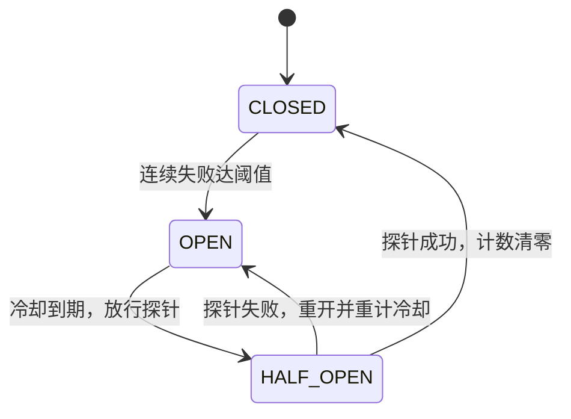
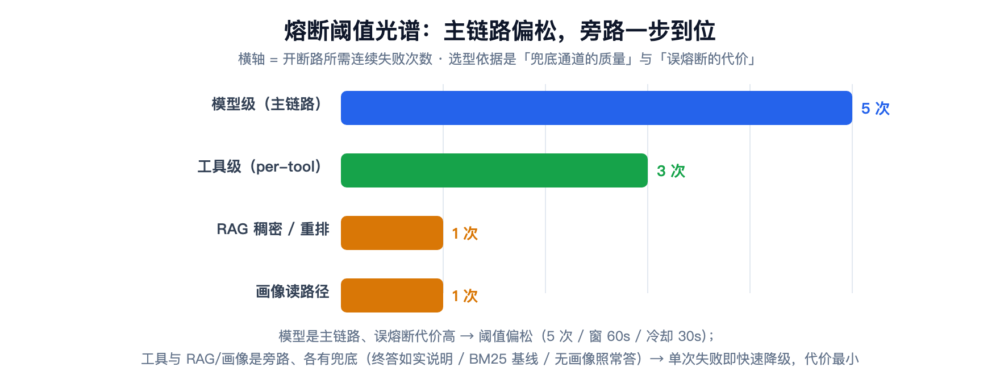

# 模型网关与韧性治理：异常分诊、重试归属地与一张熔断阈值光谱

> **语言 / Language**：中文 ｜ 系列第三章（[目录](https://blog.csdn.net/qq_24993561/article/details/166257230)）｜ 上一章：[提示词工程体系](https://blog.csdn.net/qq_24993561/article/details/166257780)
>
> **项目**：Agentdemo007 —— 电商智能客服 Agent
> **技术栈**：Java 17 / Spring Boot / 自研 resilience 包（分诊·退避·熔断）+ LangChain4j 执行器桥
> **周期**：Phase 4/5（模型网关 + 韧性层）→ 2026-09-17 Phase 17（per-tool 熔断 + 有界 Agent loop）
> **验证规模**：Phase 17 交付全量 555 GREEN（新增 10 测零回归）；resilience + gateway 累计 100+ 例单测钉死语义
> **源码**：[github.com/Gavincui123/Agentdemo007](https://github.com/Gavincui123/Agentdemo007)

---

## 核心结论

网关这一层天天要回答的问题只有一个：模型会超时、限流、宕机，工具会报错，这一轮对话怎么办。

我的答案是一套分层处置链——异常先分诊再决定重不重试，重试拆成"同模型退避"和"换模型"两个正交的轴，熔断按 5/3/1 的阈值光谱分档，预算超限收口为 HTTP 200 的话术短路（不走模型，直接回预设安抚话术）而不是 429。

设计之外，这一章还老老实实记了三个实测教训：并发丢失更新让熔断"该开不开"、一次成功就能洗白连续失败的计数、自纠正没有轮次上限就会转圈到死——每个教训最后都有一条专门写的测试钉死。

## 一、异常先分诊：不是所有异常都配重试

韧性层动工时我面对的第一个问题不是"怎么重试"，而是"什么才值得重试"。直觉方案是拿 try-catch 把出站调用包住、失败就重试——很快能发现这条路走不通：

- 401 重试多少次也还是 401，同参数重试毫无意义；
- 工具参数错了，不修正参数再试还是错；
- 注入类异常更不该重试，它根本就不该提交给 LLM。异常是带语义的，所以第一块积木不是重试器，是分诊器：所有出站异常先归入四类，每一类的处置完全不同。

| 类别 | 典型异常 | 处置 |
|---|---|---|
| `RETRYABLE_TRANSIENT` | 429 限流 / 5xx / 超时 | 指数退避重试，耗尽交故障转移 |
| `NON_RETRYABLE_CLIENT` | 401 / 403 / 404 | 立即失败——重试同参数无意义 |
| `TOOL_RECOVERABLE` | 工具参数错误 | 结构化错误反馈 LLM 自纠正 |
| `FATAL` | 注入 / 权限 | 审计失败，不提交 LLM |

判序的原则是"最致命、最特定优先"：FATAL 最先判，未知 `RuntimeException` 最后兜底为可重试。这是个乐观策略——先把每一次失败都当作偶发抖动，系统性故障交给熔断器兜底，两个机制互为对方的后备。

分诊表里最有意思的一条边界，是"提供方的 429"和"我方的 429"必须当成两种东西：

```java
// resilience/ExceptionTriage.java —— 分诊核心片段
if (t instanceof TransientException te) {
    return TriageResult.of(ExceptionCategory.RETRYABLE_TRANSIENT, te.retryAfterMs(), "瞬态可重试");
}
if (t instanceof RateLimitExceededException) {
    return TriageResult.of(ExceptionCategory.NON_RETRYABLE_CLIENT, -1L, "我方预算超限：不重试");
}
```

提供方 429 的含义是"它忙，等会儿再来"，重试有用；我方预算超限的含义是"这个窗口的额度用完了"，重试只会继续撞墙——所以归为不可重试，直接向上走话术短路（§四）。

## 二、重试的两个正交轴：再试一次和换一个是两件事

最容易写错的重试设计，是把"再试一次"和"换一个"塞进同一个循环：外层一边数次数一边换模型，同模型的退避预算和换模型的候选预算搅在一起，出了问题谁也说不清当前是第几次尝试、压在哪个模型上。所以本项目把它拆成两个执行器、两个轴：

- **同模型退避**（`ResilientExecutor`）包住单模型执行，分诊驱动的指数退避——基数 100ms、倍率 ×2、封顶 10s、全抖动；
- **换模型**（`FailoverExecutor`）逐候选各试一次，同模型的重试已由内层负责，**外层不再循环重复同模型**。

```java
// resilience/ResilientExecutor.java —— 重试模板：耗尽重抛，交 FailoverExecutor 切备
public <T> T execute(RetryAction<T> action, RetryPolicy policy) {
    for (int attempt = 0; attempt < policy.maxAttempts(); attempt++) {
        try {
            return action.call();
        } catch (RuntimeException e) {
            TriageResult result = triage.triage(e);
            boolean canRetry = result.decision() == Decision.RETRY
                    && attempt + 1 < policy.maxAttempts();
            if (!canRetry) {
                throw e;
            }
            sleeper.sleepMs(computeDelay(result, attempt, policy));
        }
    }
    throw new IllegalStateException("重试循环异常退出");
}

private long computeDelay(TriageResult result, int attempt, RetryPolicy policy) {
    if (result.retryAfterMs() >= 0) {
        return result.retryAfterMs();
    }
    long base = backoff.baseDelayMs(attempt, policy);
    if (!policy.jitter()) {
        return base;
    }
    return (long) (random.nextDouble() * (base + 1));
}
```

这段代码里有三个细节各有讲究。Retry-After 原样遵循、不二次抖动——提供方已经明确告诉你等多久，随机化它是对协议的不礼貌。全抖动的落点在执行器而不是策略里——`BackoffStrategy` 只产出确定性基数，单测断言与埋点都好办，随机化在 `ResilientExecutor` 执行时才施加，`Sleeper`/`Random` 都是注入缝。还有 `Sleeper` 被中断时要恢复中断标志——不吞中断是并发代码的礼貌底线。

这里要补一刀叠加的教训：LC4j 自带内部重试（默认 2 次、不退避、不感知熔断与 SSE 预算），它和这套自研体系叠起来，把一次 120s 的超时放大到了 121s+——多出来的时间不在自研层，全花在框架底下悄悄进行的重试上。第八章的 `maxRetries(0)` 就是给这套自研体系让路：**框架的重试关掉，重试语义只有一个归属地**。

## 三、熔断：三态机、滑动窗口与阈值光谱

### 3.1 三态机：先画状态，再谈并发

熔断器本身是个不复杂的状态机，三态：



实现上只有两处值得展开。第一处是**时钟可注入**（`LongSupplier` epochMillis）。三态流转全是时间判断——冷却到没到期、窗口滑到哪了，都看钟。不注入时钟，单测里就只能 `Thread.sleep`，墙钟一抖测试就 flaky（第四章读路径三道防线里的 WindowedCircuitBreaker 单测用的是同款做法：可注入时钟代替 sleep——同一教训的另一次重现）。

第二处是并发。Phase 17 把熔断器按 toolName 装进 `ConcurrentHashMap`，同工具的多请求线程共享同一实例。共享的那一刻，丢失更新的风险就来了：两个线程同时读到 `consecutiveFailures=4`，各自加一再写回，结果只记成 5，一次失败凭空消失——计数丢一次，熔断就晚开一次。所以注释里留了这句：

> 同 toolName 的多请求线程共享同一实例并竞态 `++consecutiveFailures`，须同步防丢失更新（**否则熔断该开不开**）。

修复是 `allowRequest`/`recordSuccess`/`recordFailure` 全部 `synchronized`，并发丢失更新有专门测试钉死。熔断器的全部价值就在"该开的时候开"，丢一次计数就是防线漏一次。

### 3.2 滑动窗口：偶发成功不该清空证据

连续失败计数还有个语义盲区：**一次成功即清零**。想一个"挂 4 次、成功 1 次、再挂 4 次"的间歇性故障——每次都快摸到阈值了，被一次成功洗白，从头再来。在连续计数下它永远不会熔断，偶发成功就这样掩盖了系统性故障。滑动窗口（`WindowedCircuitBreaker`）把语义改成"窗口内累计失败次数，**偶发成功不清窗、仅时间衰减**"。这个语义差异不是靠口头发明的，专门有一条测试钉死（`closedSuccessDoesNotClearWindow`）。

### 3.3 阈值光谱：为什么不是同一个数

熔断阈值最容易犯的错，是全系统统一一个数。可不同的依赖挂掉之后代价完全不同：有的有完美兜底，有的挂了就是整轮完蛋——用同一个阈值去套，等于宣布"所有失败的代价相等"。本项目的四个档位各有各的理由：



**模型级 5 次 / 窗 60s / 冷却 30s。** 模型是主链路，误熔断一次就是整轮话术短路，代价最高，所以阈值刻意偏松。而且是 per-model 独立计数——设计期我就否掉了"单一全局熔断"这个更简单的方案，理由很直接：单一全局熔断会阻断向备选模型切换，恰恰在最需要切备的时候锁死退路。由 per-modelId 注册表接线，熔断位于重试循环内侧。

**工具级 3 次 / 冷却 30s。** 工具失败有自纠正与"错误结果如实告知"两级兜底，但完全不设熔断也不行，3 次是平衡点。

**RAG 稠密/重排 1 次。** 这一档是被实测事故逼出来的：SiliconFlow 嵌入/重排故障期，每轮在稠密和重排上各吃一次读超时（合计约 60s），首轮直接 70s+。而本地 BM25 是恒可用基线，稠密只是可选增强——**单次失败即快速降级的代价最小**。

**画像读路径 1 次。** 有"无画像照常答"的完美兜底（第四章），误熔断几乎零代价。

一句话总结选型公式：**兜底通道越强、误熔断代价越低，阈值越激进**。另有一个记账口径的细节防误伤：参数非法、幻觉工具名、外部系统 4xx 明确拒绝**不计熔断**——外部系统有应答说明它健康，模型输错参数不该把健康工具打进熔断。

## 四、预算关卡：超限为什么返回 200 而不是 429

分诊、重试、熔断处理的都是"坏了"的情况，预算关卡处理的是另一件事：没坏，但你的份额用完了。`TokenBudgetChecker` 在模型调用**之前**校验速率与日配额，超限抛 `RateLimitExceededException`，零 LLM。有意思的是 HTTP 语义的选择：上层收口为 `RATE_LIMITED` 话术、HTTP 200，不返回 429。

我最终没选 429，理由是视角：429 对调用方的含义是"你过一会儿重试"，但**我方预算超限是业务态不是技术态**——这个窗口的额度已经用完，立即重试只会继续撞墙，该给用户的是一句人话（`RATE_LIMITED` 话术："当前咨询人数较多，请稍后再试。"）。把它做成技术错误码，前端就得为业务态写异常处理，监控里还会多一堆假 5xx/429 告警。

实现里还藏着一个日界坑：

```java
// gateway/core/TokenBudgetChecker.java —— 日配额按 UTC 日界跨天清零
// 保证「日」配额语义在长生命周期下成立，不会随进程运行而永久耗尽
```

按 `epochDay = millis / 86_400_000` 判定跨天。如果按"进程启动时刻 + 24h"滚动清零，长生命周期进程的"日"配额会变成一次性的——进程活得够久，配额就再也回不来。按 UTC 日界判定，"每日"这个语义才真正成立。

## 五、有界 Agent loop：自纠正的死循环护栏

Phase 17 之前，工具执行是"单次前向"：调一次、拿结果、走人。工具挂了就是挂了，LLM 连修正参数的机会都没有。2026-09-17 按用户裁决推翻——**有界 Agent loop**：探测 → 执行 → 失败把结构化错误（kind/根因/attempts）回喂 LLM 自纠正 → 再试，至多 `app.tool.max-iterations`（默认 2）轮。关键在"有界"两个字：轮次耗尽之后不吞不瞒，**失败结果交终答 LLM 如实向客户说明**。

```java
// capability/tool/ResilientToolExecutor.java —— per-tool 断路器包裹 + 失败收口为错误结果
public ToolInvocation invoke(ToolExecutionRequest request) {
    String name = request.name();
    if (!breaker.allow(name)) {
        // OPEN 快速失败：零工具执行，抛出由上层 ToolExecutionStep 收口 TOOL_FAILURE
        throw new ToolCircuitOpenException("工具熔断中：" + name);
    }
    AtomicInteger attempts = new AtomicInteger();
    try {
        String content = resilient.execute(() -> {
            attempts.incrementAndGet();
            return callOnce(request);
        }, retryPolicy);
        breaker.recordSuccess(name);
        return new ToolInvocation(content, null);
    } catch (ToolCircuitOpenException e) {
        throw e; // 防御透传：callOnce 不产生该类型，熔断开路必须上抛收口而非转错误结果
        } catch (RuntimeException e) {
            ToolError error = new ToolError(kindOf(e), rootMessage(e), attempts.get());
            boolean breakerWorthy = breakerWorthy(e);
            if (breakerWorthy) {
                breaker.recordFailure(name);
            }
            log.warn("工具调用失败收口为错误结果（回喂 LLM）：tool={} kind={} attempts={} breakerWorthy={} message={}",
                    name, error.kind(), error.attempts(), breakerWorthy, error.message()); // 审计
            return new ToolInvocation(error.toText(name), error);
        }
}
```

自纠正、重试、熔断三层叠在一起，护栏就三句话：**自纠正有轮次上限**（防死循环）、**重试有分诊**（防无意义重试）、**熔断有记账口径**（防误伤健康工具）。Phase 17 的验收标准原话把两件事写在一起（②＝全局纪律"每步降级"：任何依赖失败都降级继续，不让整轮崩掉）："熔断不阻塞主链路（②每步降级），不触发自纠正死循环"——风险表里登记过的"工具自纠正死循环"，最后就是由轮次上限补齐的。

## 六、PromptSanitizer：包裹是收口，也是例外管理

韧性层还顺手管了一件事：出站内容。所有经 `ChatLlmService` 的出站调用被**强制**经 `PromptSanitizer` 包裹——用户内容夹进 `[USER_INPUT_START]`/`[USER_INPUT_END]` 定界符，内容中出现的定界符先中和为 `[REDACTED]`，注入指令因此无法逃逸数据区。

值得记录的是例外：`chatRaw`（组装好的多段 prompt）**不二次包裹**。原因写在注释里：组装 prompt 内含 System/Runtime/His/RAG/Tool/User 多层，二次 sanitize 会把整条（含 System 锚点）当用户数据包裹，破坏层级结构。我更愿意要"强制收口 + 显式登记的例外"，也不要"处处 sanitize 但没人知道哪层生效"——后者看起来安全，其实是把例外藏进了运气里。

## 七、流式与容灾的边界

流式路径有一个绕不过去的物理限制：**SSE 已经吐出去的字收不回来**。如果流式中途切备或重试，用户会看到两段拼接的回答——前半句是主模型说的，后半句是备模型说的，谁也没完整讲过这句话。所以流式出站不做中途容灾；调用方（OutputStep）在流式失败时回退**阻塞 invoke**——那条路有完整的主备容灾，韧性不丢，代价是用户重等一轮。这是"韧性"与"体验"的一次明码标价：流式要流畅，容灾要完整，两者在故障场景下只能二选一，我选后者。

配套的可观测也补过一次漏。同步路径有 `FailoverExecutor` 的"LLM出站"日志行，但流式不经它——流式出站此前是零日志。我在网关层补了一行出站登记，93s 静默挂起这类"无日志空白"从此不可能再发生（第八章的教训在网关层的延伸）。

## 八、这一章带走的六条

1. **分诊先于重试。** 异常是带语义的，"重试一切"和"从不重试"一样懒。四类处置加"最致命最特定优先"的判序，让每个异常都有唯一去向。
2. **重试与故障转移是正交轴。** 内层同模型退避、外层换模型，各管各的预算；框架内置重试必须关掉，重试语义才只有一个归属地。
3. **熔断器的全部价值在"该开就开"。** 并发丢失更新、偶发成功清零证据，都是"该开没开"的变体；时钟注入让三态机可测，而不是靠 sleep 碰运气。
4. **阈值按兜底质量与误熔断代价分级**，不做全系统一刀切；记账口径（谁配计入失败）与阈值本身同样重要。
5. **业务态别伪装成技术态。** 我方预算超限收口为 HTTP 200 话术，监控与前端都更诚实。
6. **自纠正必须带轮次上限**，且耗尽后的正确动作是"如实告知"，不是静默吞掉。

## 九、已知边界（诚实清单）

1. **流式无中途容灾**：流式失败回退阻塞重跑，用户重等一轮——有意取舍，非缺陷。
2. **权重热生效仅限两次刷新之间**：dev 内存源的"热生效"语义有边界，Nacos 真源接入后收口。
3. **文档与现状的一处漂移**：开发计划记载的 `ToolExecutorCircuitTest` 已被 `ResilientToolExecutorTest` / `ToolCircuitWiringTest` 覆盖取代——计划的"产出文件"清单不追踪后续重构，语义等价但文件名已变。
4. **熔断阈值未接 Nacos**：模型/工具两档走配置文件 + 环境变量（`LLM_CB_*`、工具默认 3 次），RAG 与画像两档是代码常量（阈值 1）——热更新调参随配置中心演进。

---

*本文机制出处：`resilience/`（ExceptionTriage / ResilientExecutor / CircuitBreaker / WindowedCircuitBreaker / ModelCircuitBreaker）、`gateway/core/`（UnifiedModelGateway / FailoverExecutor / TokenBudgetChecker）、`capability/tool/`（ResilientToolExecutor / ToolCallExecutor）；三态/滑窗语义由 `WindowedCircuitBreakerTest`（8 例）钉死，并发丢失更新由 `CircuitBreakerConcurrencyTest` 钉死。*

> 相关阅读：[系列目录](https://blog.csdn.net/qq_24993561/article/details/166257230) · [第八章·全链路延迟与稳定性调优（本章的延迟视角）](https://blog.csdn.net/qq_24993561/article/details/166257713) · [下一章：会话记忆分层（同款阈值 1 的读路径三道防线）](https://blog.csdn.net/qq_24993561/article/details/166257790)
