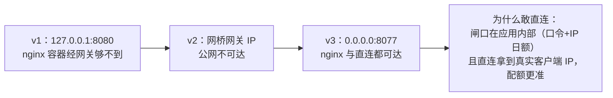
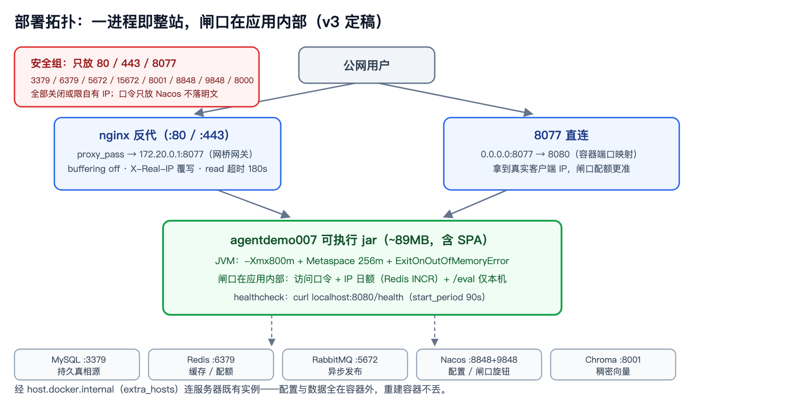
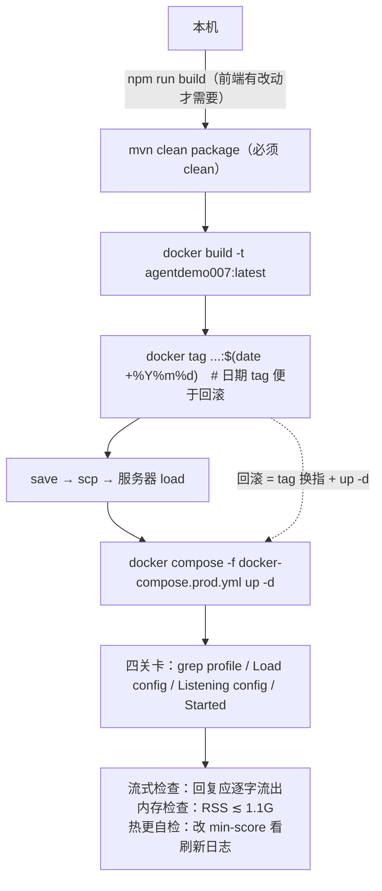

# 部署交付实录：一进程即整站——从 localhost 到公网

> **语言 / Language**：中文 ｜ 系列第十二章（[目录](https://blog.csdn.net/qq_24993561/article/details/166257230)）｜ 上一章：[可观测性与审计](https://blog.csdn.net/qq_24993561/article/details/166257770) ｜ 下一章：[链路可视化：OpenTelemetry 埋点与 Jaeger](https://blog.csdn.net/qq_24993561/article/details/167283735)
>
> **项目**：Agentdemo007 —— 电商智能客服 Agent
> **技术栈**：Spring Boot 可执行 jar（~126MB，含 SPA）/ Docker（eclipse-temurin:17-jre）/ nginx 反代 / Nacos + MySQL + Redis + RabbitMQ + Chroma
> **周期**：2026-09-18 访问闸门上线（公网前置）→ 09-20 首次公网部署 + 提交制审批收口
> **验证规模**：15+ 个真实部署问题的现象→根因→修复（完整手册见[部署实录](../guides/部署实录.md)，本章是叙事版）
> **源码**：[github.com/Gavincui123/Agentdemo007](https://github.com/Gavincui123/Agentdemo007)

---

## 核心结论

首次公网部署那天，我以为最坏的情况不过是 jar 起不来，结果当天炸出来的问题里九成根本不是代码问题，而是环境语义与代码假设的错位——代码假设 127.0.0.1 后面是 MySQL，容器里的 127.0.0.1 是容器自己；代码假设 profile 写死 prod 就完事，日志目录却归了 root；代码假设 nginx 配置改完就生效，实际上 reload 从来没有成功过。

整个交付过程我记下了 15+ 个真实问题，这一章挑最有普遍性的九个，每个都讲成现象、排查、根因、修复的完整经过，偏操作的琐碎留给番外手册按条目查。

所以这一章值得带走的不是命令清单，而是一句判断：**部署事故的第一大来源，是环境语义和代码假设对不上。**

## 一、一进程即整站：单 jar 的取舍

部署形态不是先验的设计选择，是被服务器逼出来的。我手里这台公网机器只有 2核4G，常规的"前端独立构建、nginx 托管 SPA、后端单独进程"在这里养不起：服务器上跑不动前端构建，也跑不动 Maven 构建。所以 DEPLOY.md 开头那句话我写得很直白：前端 SPA（Vue 3 / Vite）构建时直出后端 classpath:/static/，由 mvn 打入可执行 jar，后端同源托管静态资源并对外提供全部 API 与 Actuator——一进程即整站，无需独立前端服务器、无需 Nginx SPA fallback。jar 一律在本机构建好再上传，省下服务器上最贵的内存和时间。

内存口径同样跟着机器走：JVM 堆 800m 加 Metaspace 256m，容器上限压到 1280m，再挂上 `-XX:+ExitOnOutOfMemoryError`。这里我否掉了"OOM 之后让 JVM 自己缓过来"的直觉方案——半死不活的进程比当场死掉难缠得多，它还占着端口和内存，却不一定还能服务。所以我选 OOM 即重启，代价是进程当场退出，换来的是状态可预期。

镜像也不从 Docker Hub 拉。第一次部署时就吃过亏：服务器上 `dial tcp ...:443: connect: connection refused`，DNS 被污染，从公共仓库拉镜像这条路当场走死。从此镜像用 `docker save/scp/load` 整体搬运，生产服务器连 Docker Hub 都不依赖——在公网上，少一个外部依赖就少一个故障面。

单 jar 里最隐蔽的坑出在前端产物上。现象是 jar 里的 chunk 越打越多，实测从 15 个攒到 24 个。排查下来是两个事实叠加：maven-resources-plugin 只把 src/main/resources/* 复制进 target/classes/，从不删除孤儿文件；而 Vite 的 content-hash 每次构建都给 chunk 换新名字，旧文件原地留下。

于是不带 clean 的 `mvn package` 会把历代 JS chunk 全部攒进 jar。修复没有任何技巧可言，就是把 `mvn clean package` 定成发布流程里写死的步骤——"必须 clean"不是建议，是步骤。

## 二、配置的三条纪律：不写死、必验证、知边界

第一条纪律是被一次启动即炸教会的。jar 刚上服务器，进程起都没起来，报错指向 /var/log/agentdemo007/——日志目录创建失败。顺藤摸瓜发现 application.yml 里 profile 写死成了 prod，而 prod 的日志路径归 root，容器里创建不动。修复只有一行：`spring.profiles.active: ${SPRING_PROFILES_ACTIVE:dev}`。从此"profile 永远不写死在代码里"成了纪律；dataId 同理，写死的代价是换环境要改代码。修完的 import 长这样：

```yaml
# application.yml —— 占位符可从 OS 环境变量解析
spring.config.import: optional:nacos:${NACOS_DATA_ID:Agentdemo007.yaml}?group=DEFAULT_GROUP
```

第二条纪律针对 `optional:` 这把双刃剑。配置中心整个失联时应用照常启动——这是零外部依赖公理的延伸，代价是"Nacos 配置静默没加载"这种失败没有任何报错，症状只是该有的配置没有。宽容了失败，就要人工确认成功，所以发布检查里多了一条必查命令：`docker logs agentdemo007 2>&1 | grep "Load config"`。

第三条纪律是把 Nacos 热更新的能力边界背下来，原文值得整段贴在这里（DEPLOY.md 原话）：

> 没有 @RefreshScope……仅实时读取方随后生效，任何 bean 都不重建……本项目消费方式绝大多数落 ❌ 侧——**生产改配置以重启为准。改完没生效，先确认消费者的读取方式——这不是 bug。**

落到项目里：闸口旋钮、提示词模板、黄金集这三类是实时读取方，热更随后生效；数据源、连接池这类装配期 bean 落 ❌ 侧，改了也不会重建。另有一个 namespace 陷阱值得单独记一笔：`NACOS_NAMESPACE=public` 填的是显示名，而 namespace 参数必须填命名空间 ID——public 命名空间的 ID 是空串，留空即 public。这个错和静默没加载是同一种性格：不报错，只是不对。

## 三、容器网络与 MySQL：第一个炸的不是唯一错的

容器起来之后，第一波报错是 MySQL 连不上，地址写着 127.0.0.1。根因一句话就能说完：容器里的 127.0.0.1 是容器自己，不是宿主机。但这句话的推论才是关键——MySQL 只是第一个炸的，不是唯一错的：dataId 里四处地址（MySQL、Redis、RabbitMQ、Chroma）写的全是 127.0.0.1，得一处不落全部改成 `host.docker.internal`（compose 里已配好 `extra_hosts`）。这类错误的排查套路是修好眼前这一个之后，立刻想还有谁长得一样。

MySQL 授权我连踩两坑，第二个最有教育意义。表都建好了，启动仍然报 `CREATE command denied ... for table 'chat_turn'`——表已经存在，为什么还要 CREATE 权限？根因是 MySQL 在发现表已存在之前就先做权限校验，所以表建好了也必须有 CREATE 权限。这个时序很反直觉，但根因清楚之后就没有悬念：授权清单里 CREATE 不能省。

同一组配置里还埋着一个更阴的静默坑。prod 口径是 `ddl-auto: none` 加 `sql.init.mode: always`，建表这件事落在 schema.sql 头上；而 schema.sql 不显式指定 location 时，prod 将不建任何表，症状一直要到运行期所有 SQL 报错才暴露。授权、location、ddl-auto，三件套缺一不可——授权的错会当场响，这个坑是哑的。

## 四、端口绑定三次演进：0.0.0.0 赢在哪

应用起来了，下一个问题是它绑在哪、谁够得着。这个问题我换了三版答案，演进路线如下：





v1 绑 127.0.0.1:8080，本机端口冲突，而且 nginx 跑在容器里，经网关根本够不到宿主机的 loopback；v2 改绑网桥网关 IP，nginx 够到了，直连却公网不可达；v3 定稿 `0.0.0.0:8077:8080`，nginx 反代和直连都可达。

三版里真正值得展开的是 v3 那个"为什么敢"。常规思路是应用藏在内网、只让 nginx 面向公网，藏得越深越安全——这个直觉在这里恰恰不成立，因为闸口（口令 + IP 日额 + eval 封锁）做在应用内部，安全不依赖网络位置；直连发布反而拿到真实客户端 IP，配额算得更准。所以 8077 对公网开放不是妥协，是有意为之：把安全放在应用里而不是拓扑里，是这套部署里最有价值的一个决策。

nginx 侧配了三条铁律，注释就写在 conf 里：

```nginx
# 闸口配额键：必须由 nginx 覆写 X-Real-IP（$remote_addr），防客户端伪造 XFF 刷每日额度
proxy_set_header X-Real-IP $remote_addr;

# SSE 流式必需：禁缓冲 + 读超时 > 应用 SSE 窗口 120s
proxy_buffering off;
proxy_cache off;
proxy_read_timeout 180s;
```

第一行是配额信任链的起点：X-Real-IP 必须由 nginx 用 `$remote_addr` 覆写。XFF 是请求头，客户端想写什么写什么，不覆写就是无限额度——这条链的完整修复在下一节展开。后三行是流式的命脉：现象是流式回复憋到最后一次性吐出，根因是反代把 event-stream 缓冲了；`proxy_buffering off` 禁掉缓冲，`proxy_read_timeout 180s` 压过应用 120 秒的 SSE 窗口，流才逐字走得出来。

接手既有 nginx 的教训浓缩成两句。第一句：动别人的 nginx 前先查三样——Mounts（配置挂载在哪）、conf.d 是否被 include、现有 server 块。我栽的那次是改完配置页面没变，真相是 `nginx -t` 失败、reload 从未成功——而 `-t` 失败并不影响运行中的实例，老配置还在服务，没有任何报错来提醒我。**页面不变不是"没生效"，是"没加载成功"**；从那以后我的动作固定为先 `-t` 后 reload。

第二句更瘆人：杀进程前先认亲。`ps` 里一个不认识的进程摆在那，我本想清掉它，先查身份才发现 heyeAgent 是百度 HIDS 的探针，不是业务进程。从此清单里写死：`systemctl list-units` 先看一眼，`ps -ef` 加 `ss -tlnp` 双重确认身份，然后才谈得上杀不杀。

## 五、安全收尾：公网清单与诚实标注

首次公网发布之前，我把安全清单过了一遍。清单以部署实录 §7 为主，综合了 DEPLOY.md 的发布清单和[第六章](https://blog.csdn.net/qq_24993561/article/details/166257730)那条取 IP 修复链，条条可执行。更要紧的是清单保留了当时的未完成态——没修完就照实写着，修完才勾：

1. **端口收敛**。安全组只放 80 / 443 / 8077；3379 / 6379 / 5672 / 15672 / 8001 / 8848 / 9848 / 8000 这批中间件端口全部关闭或限自有 IP。清单原文记着当时的实情：这些中间件全部在公网裸着，Redis/Nacos 优先处理。
2. **密钥治理**。全部密钥经环境变量注入，配置文件只留 ${} 占位，不落明文。dataId 里写的是 `${SF_KEY}` 占位符，真值放服务器环境变量；`.env.prod` 不进仓库——我核实过 .gitignore 挡得住——文件权限收 600 仍是待办。
3. **口令只放 Nacos**。闸口 dataId `agentdemo-gate.json` 里 accessCode 字段的注释我写得斩钉截铁：只放 Nacos，勿入仓库、勿入环境变量明文。
4. **闸口发布四步**。Nacos 建 `agentdemo-gate.json` → 确认 `REDIS_ENABLED=true`（配额持久化）→ nginx `proxy_set_header X-Real-IP`（IP 防伪信任链的前提）→ 安全组只放 80/443/8077（版本口径见下方补注）。
5. **IP 伪造刷额度**的完整修复链。最初的取 IP 顺序里 XFF 优先，而 XFF 是请求头，客户端想写什么写什么——每请求换一个假 XFF，就是无限份"新鲜额度"。修复后的顺序是 X-Real-IP（nginx 覆写）→ XFF 第一跳 → TCP 对端，并且诚实标注了边界：直连场景信任 TCP 对端。

两条补注。**版本口径**：安全组"80/443/8077"是 v3 直连发布定案后的终态，DEPLOY.md 的发布清单成文较早、原文还是"80/443"，8077 是直连方案落地时追加。**2026-09-23 复查补记**：v3 直连发布后，"直连场景信任 TCP 对端"只对不带代理头的请求成立——直连请求自带伪造 X-Real-IP 时 clientIp 会优先采信它，`X-Real-IP: 127.0.0.1` 甚至能骗过 localhost 豁免（免口令免额度）；已登记 DEPLOY.md §11 排查表，收口方向：无可信代理时忽略入站代理头、只认 TCP 对端。

配置加载优先级一句话记牢：OS 环境变量 > Nacos dataId > 本地 yml。

## 六、更新与回滚：日期 tag 与四关卡验证

站点上线之后，日子才是日常：改一版怎么发，发坏了怎么退。我把流程画成了图：



这套流程的设计逻辑只有一句话：配置和数据全在容器外——Nacos、MySQL、Redis、挂载卷——重建容器什么都不丢。所以改 Nacos 配置不用重新打包；动了后端或前端代码，才需要走全流程。日期 tag 是留给回滚的活扣：`docker tag agentdemo007:20260919 agentdemo007:latest && up -d`——回滚是换指针，不是重新构建。

四关卡验证（grep profile / Load config / Listening config / Started）管的是启动层面；启动之外还有两个最容易被跳过、也最不该跳过的检查。一个是流式检查：回复应该逐字流出，憋到最后一次性吐出就要回头查反代的 buffering——这是上一节那坑的验收动作。另一个是热更自检：改 Nacos dataId 里的 app.rag.min-score 发布，数秒内日志应出现 Refresh 事件。一个验证 SSE 链路，一个验证配置链路，都是"页面打开了"验证不出来的。内存顺手看一眼：RSS ≲ 1.1G。

## 七、经验小结

把 15+ 个问题重新过了一遍，能升成经验的六条：

1. **环境语义与代码假设的错位是部署事故的第一大来源**：127.0.0.1、写死的 profile、显示名 vs ID、权限校验时序——全是"代码假设 A，环境语义 B"。
2. **`optional:` 这类宽容配置必须配对一条验证命令**：宽容了失败，就要人工确认成功。
3. **安全放在应用内部而不是拓扑里**：闸口在应用内，直连发布反而拿到更准的客户端 IP。
4. **信任链要写进配置注释**：X-Real-IP 覆写 → 闸口信任，断一环，额度系统就是摆设。
5. **"必须 clean / 必查 grep / 必测流式"是血泪换来的硬步骤**：清单化的意义是让它们不依赖记忆。
6. **回滚设计成换指针**：日期 tag 加容器外的配置数据，回滚成本约等于一条命令。

## 八、已知边界（诚实清单）

1. **安全清单是快照不是定局**：中间件端口收敛、Nacos 鉴权、dataId 内密钥轮换，清单保留了"当前未完成"的原文——公开发布前必须逐条勾完（这是部署实录 §7 的原话，不是本章转述）。
2. **无 @RefreshScope**：非实时读取方的配置改动以重启为准（见第二节）。
3. **双源提示词与本地默认无 diff 校验**（[第二章](https://blog.csdn.net/qq_24993561/article/details/166257780)同条）。
4. **密钥启动校验类不存在**：application-prod.yml 注释承诺"启动校验拒绝明文"但代码未实现（DEPLOY.md"已知缺口"登记）——承诺与实现的对账，对部署文档同样适用。

---

*本文机制出处：`DEPLOY.md`、`docs/guides/部署实录.md`（15+ 问题完整版）、`deploy/nginx-agentdemo007.conf`、`docker-compose{,.prod}.yml`、`Dockerfile`、`src/main/resources/application*.yml`、`gate/AccessGateFilter`。*

> 相关阅读：[系列目录](https://blog.csdn.net/qq_24993561/article/details/166257230) · [上一章：可观测性与审计](https://blog.csdn.net/qq_24993561/article/details/166257770) · [第六章·闸口旋钮的设计裁决](https://blog.csdn.net/qq_24993561/article/details/166257730) · [部署实录（番外·操作手册）](https://github.com/Gavincui123/Agentdemo007/blob/master/docs/guides/%E9%83%A8%E7%BD%B2%E5%AE%9E%E5%BD%95.md) · [下一章：链路可视化：OpenTelemetry 埋点与 Jaeger](https://blog.csdn.net/qq_24993561/article/details/167283735)
